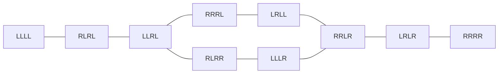

# 第 9 週習題 ── 搜尋演算法 (Search Algorithms)

> 用「搜尋法」解決 5 個經典問題：**DFS、BFS、A\*** 與 **IC 繞線 (多種方法)**。 全部使用 **純 Python 3**（只用標準函式庫），終端機彩色 / Emoji 輸出，可直接執行。

Name: 洪偉升
Department: 資訊工程學系
Student ID: 111310523
Class: Introduction to Algorithms

---

## 📑 目錄

1. [作業內容與檔案對照](#1-作業內容與檔案對照)
2. [環境與執行方式](#2-環境與執行方式)
3. [搜尋演算法速覽（先看這個）](#3-搜尋演算法速覽)
4. [第 1 題：老鼠走迷宮 — DFS](#4-第-1-題老鼠走迷宮--dfs)
5. [第 2 題：狼羊甘藍菜過河 — BFS](#5-第-2-題狼羊甘藍菜過河--bfs)
6. [第 3 題：八皇后 — DFS + 回溯](#6-第-3-題八皇后--dfs--回溯)
7. [第 4 題：NPC 搜尋玩家 — A\*](#7-第-4-題npc-搜尋玩家--a)
8. [第 5 題：IC 電路繞線 — 多種方法](#8-第-5-題ic-電路繞線--多種方法)
9. [五題總結比較與心得](#9-五題總結比較與心得)
10. [驗證方式與可擴充方向](#10-驗證方式與可擴充方向)
11. [參考資料](#11-參考資料)

---

## 1. 作業內容與檔案對照

| # | 題目 | 搜尋方法 | 程式檔 | 一句話重點 |
|---|------|----------|--------|-----------|
| 1 | 老鼠走迷宮 | **DFS** | `01_maze_dfs.py` | 堆疊 (stack) 一路走到底，死路再回溯；與 BFS 比較路徑長度 |
| 2 | 狼羊甘藍菜過河 | **BFS** | `02_wolf_goat_cabbage_bfs.py` | 建狀態空間圖，分層展開，找出**所有**最短解 |
| 3 | 八皇后 | **DFS (回溯法)** | `03_eight_queens_dfs.py` | 剪枝 + 對稱歸類：92 個解 → 12 個基本解 |
| 4 | NPC 搜尋玩家 | **A\*** | `04_npc_astar.py` | 八方向 + 地形成本 + 每 tick 重新規劃，並與 Dijkstra / Greedy 比較 |
| 5 | IC 電路繞線 | **Lee(BFS) / Dijkstra / A\* / Steiner / 排序搜尋 / rip-up** | `05_circuit_routing.py` | 兩層金屬、via、多接腳 net、繞線順序的影響 |

```
hw9_search/
├── 01_maze_dfs.py
├── 02_wolf_goat_cabbage_bfs.py
├── 03_eight_queens_dfs.py
├── 04_npc_astar.py
├── 05_circuit_routing.py
└── README.md        ← 你正在看的這份
```

---

## 2. 環境與執行方式

- **Python 3.8 以上**，**不需要安裝任何第三方套件**。
- 建議使用支援 **UTF-8 / 256 色 / Emoji** 的終端機（Windows Terminal、VS Code 終端機、macOS Terminal、Linux 終端機皆可）。
- Windows 舊版 `cmd` 若出現亂碼，先執行 `chcp 65001`；程式內已加上 `os.system("")` 讓 Windows 開啟 ANSI 顏色支援。
- 想要純文字輸出（例如要貼進報告）：設定環境變數 `NO_COLOR=1`（程式會自動換成純文字符號）。

```bash
python 01_maze_dfs.py                   # 老鼠走迷宮
python 01_maze_dfs.py --animate         # 動畫：看老鼠一格一格探索
python 01_maze_dfs.py --seed 3 --width 41 --height 19   # 換一張迷宮

python 02_wolf_goat_cabbage_bfs.py      # 狼羊甘藍菜

python 03_eight_queens_dfs.py           # 八皇后
python 03_eight_queens_dfs.py -n 10     # 十皇后

python 04_npc_astar.py                  # NPC 追玩家 (快照)
python 04_npc_astar.py --animate        # NPC 追玩家 (動畫)

python 05_circuit_routing.py            # IC 繞線 (約 1 秒)
```

> 提示：所有迷宮 / 模擬都用**固定亂數種子**，所以每次執行結果都能重現，方便寫報告與驗證。

---

## 3. 搜尋演算法速覽

先把本週用到的三個核心演算法放在同一張表，方便對照：

| | **DFS** 深度優先 | **BFS** 廣度優先 | **A\*** |
|---|---|---|---|
| 資料結構 | 堆疊 Stack (LIFO) / 遞迴 | 佇列 Queue (FIFO) | 優先佇列 Priority Queue (min-heap) |
| 展開順序 | 先往深處走，撞牆才回頭 | 一層一層往外擴 | 依 `f(n)=g(n)+h(n)` 最小者先展開 |
| 保證找到解？ | 有限圖 ✔（無限深度圖可能走不出來） | ✔ | ✔ |
| 保證最短 / 最佳？ | ✘ | ✔（每步成本相同時） | ✔（`h` 可採納 admissible 時） |
| 時間 | O(V+E) | O(V+E) | O(E log V)（實務上遠少於 Dijkstra） |
| 空間 | **O(深度)**（通常最省） | O(V)（最吃記憶體） | O(V) |
| 適合 | 「存在性 / 列舉所有解」：迷宮、N 皇后、回溯 | 「最少步數」：過河、最短路 | 「有成本 + 有方向感」：遊戲尋路、繞線 |

**三者其實是同一個骨架，只差「下一個要展開誰」：**

```text
frontier = [start]
while frontier 不為空:
    node = frontier.取出()        # DFS: 取最新的 (stack)
                                  # BFS: 取最舊的 (queue)
                                  # A* : 取 f 最小的 (priority queue)
    if node 是目標: 回傳路徑
    for 每個合法的鄰居 nb:
        frontier.放入(nb)
```

---

## 4. 第 1 題：老鼠走迷宮 — DFS

📄 `01_maze_dfs.py`

### 4.1 題目與建模

| 項目 | 內容 |
|---|---|
| 問題 | 老鼠 🐭 從左上角出發，找到右下角的起司 🧀 |
| 狀態 | 迷宮格座標 `(x, y)` |
| 動作 | 往 上 / 右 / 下 / 左 移動到不是牆的鄰格 |
| 目標 | `(寬-2, 高-2)` |

### 4.2 方法：DFS（顯式堆疊）

- 為什麼不用遞迴？大迷宮遞迴深度可能超過 Python 的限制 (`RecursionError`)，所以用**顯式堆疊**。
- 流程：
  ```text
  stack = [(start, None)]
  while stack:
      cur, parent = stack.pop()
      if cur 已走過: continue          # 避免走回頭路 / 無窮迴圈
      標記走過、記錄 parent[cur] = parent
      if cur == goal: break
      把 cur 所有「沒走過的非牆鄰居」push 進 stack
  由 goal 沿 parent 一路回溯 → 得到路徑
  ```
- 方向優先順序是「上→右→下→左」（實作時以 `reversed(DIRS)` 推入，使「上」最先被 pop）。
- **回溯次數**：若這次 pop 出來的格子的 parent 不是「上一步走到的格子」，代表上一步走進死路，退回到更早的分岔點，計為一次回溯。

### 4.3 迷宮如何產生？

用「遞迴回溯法 (Recursive Backtracker)」— 它本身也是一個 DFS：從 `(1,1)` 開始隨機挑沒去過的鄰居、打通牆壁往前走，走不下去就退回。這樣得到**完美迷宮**（任兩點恰一條路）。
再隨機多打通 `--loops` 面牆造出**環路**，這樣才會有「多條路徑」，才看得出 DFS 找到的路**不一定最短**。

### 4.4 輸出範例（`seed=7`，31×15）

```text
🎉 DFS 找到起司了！ (•• = 最終路徑，░░ = 走過但不在路徑上)
██████████████████████████████████████████████████████████████
██🐭██    ••••••░░░░░░░░██••••••••••••••••••••••••••██░░░░░░██
██••██████••██••██████████••██████████  ██████  ██••██░░██░░██
██••••••██••██••••••••••••••            ██      ██••██░░██░░██
██████••██••██████████████████████  ██  ██  ██████••██░░██░░██
██  ██••██••██      ██              ██  ██    ••••••██░░██░░██
██  ██••██••██  ██  ██  ██████████  ██  ██    ••██████████░░██
██  ██••••••            ██          ██      ██••••••••••••••██
██  ██████████████████████  ██████████████  ██████████████••██
██          ██                              ██          ██••██
██  ██████  ██  ██  ██  ██████  ██  ██████████  ██████████••██
██          ██  ██  ██      ██      ██              ██••••••██
██  ██  ██████  ██  ██  ██████  ██████  ██  ██  ██  ██••██████
██  ██          ██                      ██            ••••🧀██

  DFS 走訪格數      : 81
  DFS 回溯次數      : 2
  DFS 堆疊最大深度  : 9
  DFS 路徑長度      : 64 步
  BFS 走訪格數      : 216
  BFS 最短路徑長度  : 54 步
  → DFS 的路徑比最短路多繞了 10 步 (19%)
```

另外程式還會列出「前 10 個分岔點 / 死路」事件，讓你看到 stack 如何增減：

```text
  第 11格 (5, 7)   🔀 分岔路口  push 2 個新鄰居，堆疊現有  2 個待辦
  第 23格 (11, 1)  💀 死路！  沒有新鄰居可 push → 下一步 pop 會退回舊分岔，堆疊現有  3 個待辦
```

### 4.5 觀察與結論

- DFS **只走了 81 格**就找到起司，比 BFS 的 216 格少很多 → DFS 運氣好時很省。
- 但 DFS 的路徑 **64 步 > 最短 54 步**：DFS 只保證「找得到」，**不保證最短**。
- 需要最短路請改用 BFS（程式已實作 `bfs()` 作為對照）。
- DFS 的空間用量只有「目前路徑上的分岔數」(最大堆疊深度 9)，而 BFS 要存整圈波前。

---

## 5. 第 2 題：狼羊甘藍菜過河 — BFS

📄 `02_wolf_goat_cabbage_bfs.py`

### 5.1 題目

農夫要把狼🐺、羊🐐、甘藍菜🥬 從左岸運到右岸。船一次只能載「農夫 + 最多一樣東西」。農夫不在場時：**狼會吃羊、羊會吃甘藍菜**。問最少要渡河幾次？

### 5.2 建模 — 把「謎題」變成「圖」

- **狀態** = `(農夫, 狼, 羊, 菜)`，每個值 `0`=左岸、`1`=右岸 → 2⁴ = **16** 種。
- **合法狀態**：沒有「狼和羊單獨同岸」、也沒有「羊和菜單獨同岸」→ 剩 **10** 種。
- **動作**：農夫獨自過河，或帶一樣**與他同岸**的東西過河；渡河後新狀態必須合法。
- **起點** `LLLL`，**終點** `RRRR`（L=左岸、R=右岸，順序為 農夫/狼/羊/菜）。



### 5.3 為什麼用 BFS？

每次渡河成本都是 1，BFS 一層一層展開 → **第一次碰到終點的那一層，就是最少渡河次數**。
本程式更進一步：每個節點記錄**所有**能以最短距離到達它的前驅 (`parents[v]` 是 list)，因此可以從終點回溯出「**全部**最短解」，而不只是一個。

### 5.4 輸出範例

BFS 分層：

```text
  第 0 層 (1 個狀態)：LLLL
  第 1 層 (1 個狀態)：RLRL
  第 2 層 (1 個狀態)：LLRL
  第 3 層 (2 個狀態)：RRRL  RLRR      ← 這裡開始分岔 → 兩種解
  第 4 層 (2 個狀態)：LRLL  LLLR
  第 5 層 (1 個狀態)：RRLR
  第 6 層 (1 個狀態)：LRLR
  第 7 層 (1 個狀態)：RRRR
```

解法 #1 的視覺化（每步附場景圖）：

```text
  第 1 次：農夫帶著 🐐羊 過河 (左岸 → 右岸)
        🏝 [   🐺    🥬] 🌊  ≈≈≈≈≈≈≈≈≈≈🛶🌊 [👨    🐐   ] 🏝    RLRL
  第 2 次：農夫獨自過河 (右岸 → 左岸)
  第 3 次：農夫帶著 🐺狼 過河 (左岸 → 右岸)
  第 4 次：農夫帶著 🐐羊 過河 (右岸 → 左岸)      ← 關鍵：把羊「帶回來」
  第 5 次：農夫帶著 🥬甘藍菜 過河 (左岸 → 右岸)
  第 6 次：農夫獨自過河 (右岸 → 左岸)
  第 7 次：農夫帶著 🐐羊 過河 (左岸 → 右岸)
```

### 5.5 結論

- **最少 7 次渡河**，共 **2 種最短解**（差別只在「狼」與「菜」誰先過河，兩者互不傷害）。
- 關鍵技巧是**把羊帶回來** — 這在 BFS 的狀態圖上就是一條「回頭邊」，人類容易忽略，但搜尋會自動找到。
- BFS 只展開 10 個節點（整個合法狀態空間），而且 `visited`（用 `dist` 字典）避免了在狀態圖上繞圈。

---

## 6. 第 3 題：八皇后 — DFS + 回溯

📄 `03_eight_queens_dfs.py`

### 6.1 題目

在 8×8 棋盤放 8 個皇后，使任兩個皇后不在同一列、同一行、同一斜線。

### 6.2 建模（關鍵：降低搜尋空間）

| 方法 | 搜尋空間 |
|---|---|
| 暴力：64 格選 8 格 | C(64, 8) = **4,426,165,368** |
| 每列恰好一個皇后 | 8⁸ = **16,777,216** |
| **每列一個 + 邊放邊剪枝 (本程式)** | 只展開 **2,056** 個節點 |

- **搜尋樹**：第 `r` 層 = 決定「第 `r` 列」的皇后放哪一行 → 「同列衝突」在建模時就消失。
- **衝突檢查 O(1)**：三個集合
  - `cols`：已被占用的**行**
  - `d1`：主對角線 `r - c`
  - `d2`：副對角線 `r + c`
- **DFS + 回溯**：

```python
def dfs(r):
    if r == n: 記錄解; return
    for c in range(n):
        if c in cols or (r-c) in d1 or (r+c) in d2: continue   # 剪枝
        放置 (r, c)          # 做選擇
        dfs(r + 1)           # 往下一層
        撤銷 (r, c)          # 回溯：復原狀態
```

### 6.3 對稱歸類（12 個基本解）

一個解經過 **4 種旋轉 × 2 種鏡射 = 8 種對稱變換**後，會得到最多 8 個「看起來不同、本質相同」的解。
程式對每個解算出所有變換，取字典序最小的當代表 → 92 個解歸為 **12 類**：

- 11 類各有 8 個等價解 → 88
- 1 類只有 4 個等價解（它自己旋轉 180° 會得到自己）→ 4
- 驗算：`8×11 + 4×1 = 92` ✔

### 6.4 輸出範例

搜尋軌跡（縮排 = 深度）：

```text
  放置 ♛ 第 1 列 第 a 行
    放置 ♛ 第 2 列 第 c 行
      放置 ♛ 第 3 列 第 e 行
        放置 ♛ 第 4 列 第 b 行
          放置 ♛ 第 5 列 第 d 行
            死胡同 ☠ 第 6 列        ← 第 6 列所有位置都被攻擊 → 回溯
          撤銷 ✖ 第 5 列 第 d 行
```

第一個解（`solution = [0, 4, 7, 5, 2, 6, 1, 3]`）：

```text
 1 ♛ · · · · · · ·
 2 · · · · ♛ · · ·
 3 · · · · · · · ♛
 4 · · · · · ♛ · ·
 5 · · ♛ · · · · ·
 6 · · · · · · ♛ ·
 7 · ♛ · · · · · ·
 8 · · · ♛ · · · ·
   a b c d e f g h
```

規模統計：

```text
    N │      解數 │    基本解 │      DFS節點 │              N^N
    4 │       2 │      1 │         16 │              256
    6 │       4 │      1 │        152 │           46,656
    8 │      92 │     12 │      2,056 │       16,777,216   ◀
   10 │     724 │     92 │     35,538 │   10,000,000,000
```

### 6.5 結論

- 找到**第一個解**只需成功放置 113 次；**列舉全部 92 個解**也只展開 2,056 個節點。
- 「**剪枝**」是回溯法的靈魂：一旦發現這條路必死，就整棵子樹放棄。
- 最壞情況時間仍是指數級（約 O(N!)），所以 N 越大成長越快（N=10 已 35 萬節點量級→3.5 萬；N 更大需更聰明的方法如位元運算、對稱剪枝、最小衝突法）。

---

## 7. 第 4 題：NPC 搜尋玩家 — A\*

📄 `04_npc_astar.py`

### 7.1 題目與設定

地圖上有牆、草地、森林、沼澤。👹 NPC 要追捕會逃跑的 🧑 玩家。

| 地形 | 符號 | 移動成本 |
|---|---|---|
| 草地 | 空白 | 1 |
| 森林 | `♣♣` | 2 |
| 沼澤 | `≈≈` | 5 |
| 牆 | `▓▓` | 不可通行 |

- **八方向移動**，斜走成本 ×√2。
- **不穿牆角 (no corner-cutting)**：斜走時，兩旁相鄰的兩格都不能是牆。
- 步驟成本 = `(1 或 √2) × 目的格地形成本`。

### 7.2 A\* 原理

```text
f(n) = g(n) + h(n)
g(n) : 起點到 n 的「實際」最小花費
h(n) : n 到終點的「估計」花費  →  Octile 距離：  (dx + dy) + (√2 − 2)·min(dx, dy)
```

- **可採納 (admissible)**：`h` 絕不高估真實花費（地形最低成本是 1，所以用成本 1 算的 Octile 距離不會高估）→ **保證最佳解**。
- 實作：`heapq` 優先佇列 + `g_score` 字典 + `closed` 集合；用「遞增計數器」當 tie-breaker 避免比較 tuple 時比到座標。
- 同一份程式用 `mode` 切換三種演算法做比較：

| mode | 排序依據 | 特性 |
|---|---|---|
| `astar` | `g + h` | 最佳 + 有方向感 |
| `dijkstra` | `g` | 最佳，但像水波一樣四面擴散 |
| `greedy` | `h` | 很快，但**不保證最佳**，會被沼澤 / 牆誘導繞遠路 |

### 7.3 追逐模擬

- NPC 每個 tick 走 1 步，玩家每 2 個 tick 走 1 步（NPC 速度是 2 倍）。
- **玩家逃跑 AI**：在幾個「安全點」中，挑 `NPC 到該點花費 − 1.5 × 玩家到該點花費` 最大者 (也是用 A\* 算的)，每 6 步重新選。
- **NPC 每個 tick 都重新規劃** A\*（因為玩家位置變了）。
- 當兩者的切比雪夫距離 ≤ 1 時視為抓到。

### 7.4 輸出範例

同一個查詢（NPC → 玩家初始位置）三種演算法比較：

```text
  演算法              路徑花費       最佳?      展開節點      路徑格數
  A*               36.73      ✔ 最佳       185        34
  Dijkstra         36.73      ✔ 最佳       396        34
  Greedy BFS       59.11   ✘ +22.4        51        38
```

追逐結果：

```text
  💥 NPC 在第 33 個 tick 抓到玩家！
  重新規劃次數      : 34
  A* 累計展開節點   : 1,511  (平均每次 44)
  若用 Dijkstra     : 7,832  (平均每次 230)
  A* 節省           : 81% 的搜尋量
```

（彩色終端機中，被展開的格子會泛黃、最終路徑以黃色 `••` 標示；加 `--animate` 可看 NPC 追逐動畫。）

### 7.5 結論

- **A\* 與 Dijkstra 找到一樣便宜的路徑**（36.73），但 A\* 少展開 **53%**；在整場追逐中累計節省 **81%**。
- **Greedy** 只看 `h` 所以展開最少（51），但路徑貴了 22.4 → 「快但不準」。
- 距離越近，A\* 展開越少（追逐最後幾個 tick 只展開 2~4 格）→ 適合**每個 tick 都要重新規劃**的遊戲 AI。
- 地形成本讓 NPC 自動**繞開沼澤**（寧可多走幾格草地），這是單純 BFS 做不到的。

---

## 8. 第 5 題：IC 電路繞線 — 多種方法

📄 `05_circuit_routing.py`

### 8.1 問題

晶片上有被巨集方塊 (macro) 占據的區域與數條**網路 (net)**，每條 net 要把 2 個以上的**接腳 (pin)** 用金屬導線連起來：

- 導線不能穿過障礙物；
- **不同 net 的導線不可重疊**（否則短路）；
- 多層金屬之間用**通孔 (via)** 換層；
- 目標：全部連通，**總線長短、via 少**。

IC 實務上分兩階段：**全域繞線 (global routing)** 先粗略分配走哪些區域，**細部繞線 (detailed routing)** 再在格點上真正畫線。本題實作細部繞線的核心搜尋。

### 8.2 本程式模型

- 格點圖 34×15、**兩層金屬**：`M1`（偏好水平）、`M2`（偏好垂直）。
- 狀態 = `(層, x, y)`；動作 = 上下左右一步，或在同一座標用 via 換層。
- **成本模型**（模擬真實製程偏好）：順向一步 **1**、逆向一步 **3**、via **6**。
- 障礙：`▒▒` 巨集只擋 M1（M2 可跨越）；`▓▓` 兩面交錯的牆兩層都擋 → 通道被擠成 **S 形**，製造「繞線擁擠」。
- 共 5 條 net：A、B、D、E 為 2 接腳，**C 為 3 接腳**。

### 8.3 實作了哪些方法？

| 方法 | 在程式中 | 保證 | 說明 |
|---|---|---|---|
| ① **Lee 演算法 (Maze Router)** | `lee_demo()` (Ⓐ) | 單層最短 | 本質就是 **BFS**：從 S 一圈圈往外填距離（擴張），碰到 T 後沿「距離遞減 1」走回 S（回溯），再把路徑標記成佔用（清除）。1961 年提出，至今仍是繞線演算法的基石。缺點：沒有方向感，填滿整片區域，時間與記憶體 O(W·H) |
| ② **Dijkstra (含成本模型)** | `route_to(..., "dijkstra")` | 最小成本 | 有「方向偏好 / via 懲罰」時 BFS 不夠，要用 Dijkstra（BFS 的加權版） |
| ③ **A\*** | `route_to(..., "astar")` | 最小成本 | 在②加上曼哈頓距離 `h`（每步最低成本 1 → 可採納），展開節點明顯更少 |
| ④ **多接腳 net：Steiner-tree 式 / Prim 式擴張** | `route_all()` | 近似 | 3 接腳以上的 net：以「**已繞好的整棵樹**」為**多重起點**，每次連到距離最近的下一個 pin |
| ⑤ **繞線順序搜尋** | Ⓒ 窮舉 5! = 120 種 | 此規模下可得最佳順序 | 先繞的 net 會擋住後面的 → 順序會影響成敗與成本 |
| ⑥ **簡化版 Rip-up & Reroute** | Ⓒ 下半 | 啟發式 | 發現某條 net 被堵死 → 拆掉重來，把失敗的 net 提到最前面再繞 |

### 8.4 其他方法（說明，未全部實作）

| 方法 | 重點 |
|---|---|
| **Hadlock (1977)** | Lee 的改良：以「繞道次數 (detour number)」取代距離當波前優先權，波前更窄、更快，路徑仍最短 |
| **Line-Probe：Mikami-Tabuchi (1968)、Hightower (1969)** | 不逐格擴張，而是從 S、T 兩端沿**直線**探測、遇障礙才轉彎。記憶體小、速度快，但不保證最短 |
| **Channel Routing / Left-Edge Algorithm** | 規則通道 (兩排 pin 中間的空間) 內做「軌道 (track) 指派」，類似區間著色 (interval graph coloring) |
| **Rip-up & Reroute / PathFinder (McMurchie & Ebeling, 1995)** | 允許暫時重疊，並隨疊代提高壅塞區的成本，讓各 net「協商」出無衝突的解；FPGA 與先進 IC 工具都用這類 |
| **Steiner Tree (Rectilinear Steiner Minimal Tree)** | 多接腳 net 的最小總線長（NP-hard），實務用 FLUTE 等查表 / 啟發式 |
| **整數線性規劃 (ILP) / 多商品流 (multi-commodity flow)** | 全域繞線的精確建模，規模大時求解成本高 |
| **Global + Detailed Routing** | 先把晶片切成 tile 做全域規劃，再在每個區域做細部繞線，降低搜尋空間 |

### 8.5 輸出範例

**Ⓐ Lee 波前**（數字 = 距 S 的最短步數；最後黃底路徑長度 37）：

```text
▓▓▓  2  1  2  3  4  5  6▓▓▓ 20 21 22 23 24 25 26 27 28 29 30 31 32 33▓▓▓
▓▓▓  1 S   1  2  3  4  5▓▓▓ 19 20 21 22 23 24 25 26 27 28 29 30 31 32▓▓▓
  ...
▓▓▓  7  6  7  8  9 10 11 12 13 14 15 16 17 18▓▓▓ 32 33 34 35 36 T  · ▓▓▓
```

**Ⓒ 繞線順序的影響**：

```text
  窮舉 120 種順序 (5!) → 100 種全部繞通、20 種有 net 被堵死。
  被堵死的 net 次數： C×20

  順序                 總成本     線長   via   說明
  A→B→C→D→E          270    164    13   預設順序：✔ 全部繞通
  B→D→C→A→E          258    162    11   最佳順序：✔ 全部繞通
  A→D→C→E→B          309    175    12   最差(但能繞通)：✔ 全部繞通

  → 能繞通的順序之間，總成本最多差 51 (20%)。

  【簡化版 rip-up & reroute】從一個會失敗的順序出發：
   第1輪  順序 B→D→A→C→E  ✘ C 被堵死 → 拆掉全部導線，把 C 提到最前面再繞
   第2輪  順序 C→B→D→A→E  ✔ 全部繞通  (成本 268，via 13)
```

**Ⓓ A\* vs Dijkstra**（順序 B→D→C→A→E）：

```text
  net     接腳     A* 成本     A* 展開    Dij 成本    Dij 展開      節省
  B        2        22       104        22       314     67%
  D        2        44       246        44       656     62%
  C        3        67       612        67      1162     47%
  A        2        93       610        93       637      4%
  E        2        32       153        32       317     52%
  合計               258      1725       258      3086     44%
```

**Ⓔ 最佳繞線結果**（M1 層；`◉` = via，字母 = pin，線條用盒狀字元畫出轉角與分岔）：

```text
· · · · · · · · · · · · · · · · ▓▓▓▓◉───────────────────────────◉ ·
· · · · · · · · · · · · · E · · ▓▓▓▓· · · · · · ▓▓▓▓▓▓▓▓▓▓▓▓· · · ·
· · · · ▒▒▒▒▒▒▒▒▒▒▒▒▒▒· · · · · ▓▓▓▓· · · C · · ▓▓▓▓▓▓▓▓▓▓▓▓· · · ·
· · A─┐ ▒▒▒▒▒▒▒▒▒▒▒▒▒▒· · · · · ▓▓▓▓· · · · · · ▓▓▓▓▓▓▓▓▓▓▓▓· · · ·
· · · │ ▒▒▒▒▒▒▒▒▒▒▒▒▒▒B─◉ · · · ▓▓▓▓· · · · · · ▓▓▓▓▓▓▓▓▓▓▓▓· · · ·
· · · │ ▒▒▒▒▒▒▒▒▒▒▒▒▒▒· ┌─────◉ ▓▓▓▓· · · ┌───────────────────────┐
· · · └─────────────────┘ ┌───────────────┘ ▓▓▓▓◉───────────────C │
· D───────────────────────┘ ▒▒▒▒▒▒▒▒▒▒▒▒▒▒· ▓▓▓▓· · · · · · · · · D
  ...
```

### 8.6 結論

- **Lee = BFS**：最短但「盲目」；**A\*** 加上方向感，在相同成本模型下找到**同樣便宜**的路徑，整體少展開約 **44%**（個別 net 最多 87% 的差異取決於地形）。
- 多接腳 net 不是「兩兩連線」，而是把**已連通的整棵樹**當起點去連下一個 pin → 這正是 Steiner tree 近似的做法。
- **繞線有「先來後到」問題**：120 種順序中 20 種直接失敗、成功的順序成本也差到 20%。這說明為什麼實務上需要 rip-up & reroute / 壅塞協商，而不是一次繞完就結束。
- 程式另外用並查集 (union-find) 驗證過：**全部 120 種順序的所有成功 net（共 580 條）都連通 pin、沒有穿過障礙物、沒有 net 重疊**。

---

## 9. 五題總結比較與心得

| 題 | 演算法 | 為什麼選它 | 關鍵資料結構 | 最大收穫 |
|---|---|---|---|---|
| 1 迷宮 | DFS | 只要「找到出口」，空間省 | stack | DFS 快但**不保證最短** |
| 2 過河 | BFS | 要「最少步數」 | queue + dist/parents | 把謎題**建模成狀態圖**；BFS 能列出**所有**最短解 |
| 3 八皇后 | DFS + 回溯 | 要「列舉所有解」 | 遞迴 + 集合 (O(1) 衝突檢查) | **剪枝**把 1600 萬降到 2056；對稱性歸類 |
| 4 NPC | A\* | 有成本、有目標、要即時 | heap + g_score | **好的啟發函式**省 50~80% 搜尋；Greedy 快但不準 |
| 5 繞線 | BFS(Lee) → Dijkstra → A\* + 順序搜尋 | 多層、有成本、多條線互相影響 | heap + occupancy map | **單條最佳 ≠ 整體最佳**，要看順序與壅塞 |

**選演算法的心法：**

1. **要不要最短 / 最佳？** 不要 → DFS；要 → BFS（成本相同）或 Dijkstra / A\*（成本不同）。
2. **有沒有好的 `h` 估計？** 有 → A\*；沒有 → Dijkstra。
3. **要不要列舉全部解？** → DFS + 回溯 + 剪枝。
4. **記憶體是不是瓶頸？** → DFS 最省；BFS / A\* 要存整個邊界。
5. **問題會不會「動態變化」？** → 每次變化重新規劃（第 4 題）；A\* 夠快才行。

---

## 10. 驗證方式與可擴充方向

**已做的驗證**

- 第 1 題：以固定 seed 重現；DFS 與 BFS 路徑長度對照，確認 BFS 為最短、DFS 路徑合法。
- 第 2 題：狀態圖 10 個合法狀態全可達；最短距離 7，與已知經典解相符；回溯出 2 種最短解。
- 第 3 題：解數 92、基本解 12 與 N=4~10 的已知數列 (2, 10, 4, 40, 92, 352, 724) 完全吻合。
- 第 4 題：A\* 與 Dijkstra 成本相同（最佳性）；追逐過程中玩家與 NPC 不會走進牆。
- 第 5 題：對 120 種順序 × 全部成功 net 做連通性、重疊、障礙檢查，違規 0 件。

**可以再擴充**

- 第 1 題：加入 IDA\* / 雙向 BFS；改成「大迷宮 + 多出口」。
- 第 3 題：用位元運算加速；用「最小衝突法 (min-conflicts)」解 N=1000 皇后。
- 第 4 題：加入 JPS (Jump Point Search)、動態障礙物、D\* Lite（地圖變動時只更新必要部分）。
- 第 5 題：加入 Hadlock、PathFinder 壅塞協商、三層以上金屬、時序 / 串擾成本。

---

## 11. 參考資料

- Russell, S. & Norvig, P. *Artificial Intelligence: A Modern Approach* — 第 3 章（搜尋）、第 6 章（限制滿足 / 回溯，N 皇后）。
- Hart, P. E., Nilsson, N. J., Raphael, B. (1968). *A Formal Basis for the Heuristic Determination of Minimum Cost Paths* — A\* 原始論文。
- Dijkstra, E. W. (1959). *A Note on Two Problems in Connexion with Graphs*.
- Lee, C. Y. (1961). *An Algorithm for Path Connections and Its Applications*, IRE Trans. Electronic Computers — Lee 演算法。
- Hadlock, F. O. (1977). *A Shortest Path Algorithm for Grid Graphs*, Networks.
- Mikami, K. & Tabuchi, K. (1968). *A Computer Program for Optimal Routing of Printed Circuit Connectors*; Hightower, D. W. (1969). *A Solution to Line-Routing Problems on the Continuous Plane*.
- McMurchie, L. & Ebeling, C. (1995). *PathFinder: A Negotiation-Based Performance-Driven Router for FPGAs*.
- Sherwani, N. *Algorithms for VLSI Physical Design Automation* — 繞線 (routing) 章節。