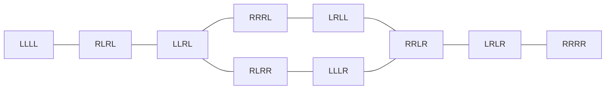

# Homework 1: power2n(n)

> This README was created with the help of Claude AI.

Name: 洪偉升
Department: 資訊工程學系
Student ID: 111310523
Class: Introduction to Algorithms 

## Assignment

Implement `power2n(n)` to compute 2 to the power of n, and compare the following four
implementations at `n = 100`:

1. **Method 1**: direct use of Python's built-in exponentiation `2 ** n`
2. **Method 2a**: recursion, `power2n(n) = power2n(n-1) + power2n(n-1)`
3. **Method 2b**: recursion, `power2n(n) = 2 * power2n(n-1)`
4. **Method 3**: recursion + lookup table (memoization)

## Files

- `power2n.py`: the four implementations, plus a main program that tests and times each one

## Method explanations

### Method 1: `2 ** n`
Uses Python's built-in power operator directly (implemented internally with fast exponentiation, roughly O(log n)). This is the fastest method.

### Method 2a: `f(n-1) + f(n-1)`
This looks like it halves the problem size at each step, but it actually calls
`power2n(n-1)` **twice**. Each level of recursion doubles the number of calls,
so the total number of calls is O(2^n). At `n = 100` that's about 2^100 calls
(roughly 10^30), which no computer could finish in any reasonable amount of time.
This method effectively never completes for n = 100.

### Method 2b: `2 * f(n-1)`
Calls `power2n(n-1)` only once, reducing the problem size by 1 each time.
Time complexity is O(n), so n = 100 only needs 100 levels of recursion and runs quickly.

### Method 3: recursion + lookup table
Builds on method 2b by adding a dictionary (table) that stores values already computed.
If the same `n` is requested again, it's looked up directly instead of being
recomputed. For this particular problem there's no repeated computation of the
same `n`, so the table doesn't provide a real speed advantage here complexity
is still O(n) but it demonstrates memoization, a technique that's very useful
for recursions with overlapping subproblems (e.g. Fibonacci).

## Test results (n = 100)

| Method | Completes? | Time |
|---|---|---|
| Method 1 (2**n) | Yes | ~0.01 sec |
| Method 2a (f(n-1)+f(n-1)) | No timeout, still not done after 5 sec | — |
| Method 2b (2*f(n-1)) | Yes | ~0.005 sec |
| Method 3 (recursion + table) | Yes | ~0.003 sec |

(Exact numbers vary by machine, but method 2a will never finish at n = 100 in a
reasonable amount of time. The timeout in `power2n.py` is implemented with
`multiprocessing` each method runs in its own process so it can be forcibly
killed after 5 seconds on any OS, including Windows, where the Unix-only
`signal.alarm` is not available. This adds a small process-spawn overhead
of a few milliseconds to the measured times, but it does not change which
method is fastest or which one times out.)

## Conclusion

- **Fastest**: Method 1 (built-in exponentiation)
- **Slowest / never finishes**: Method 2a, because the number of calls grows
  exponentially as O(2^n)
- Methods 2b and 3 are both O(n) and run at similar speed. Method 3's lookup
  table doesn't help *for this specific problem*, but it illustrates how
  memoization a common optimization technique is written.

---

# Homework 2: Solving Recurrence Relations

> This README was written by Claude AI to explain the step-by-step solutions.

Name: 洪偉升
Department: 資訊工程學系
Student ID: 111310523
Class: Introduction to Algorithms 


## Overview

This homework asks us to find the **exact closed-form formula** and the
**Big O** growth rate for four recurrence relations. The method used
throughout is **unrolling (repeated substitution)**: we expand the
recurrence step by step until a clear pattern appears, then sum that
pattern using either an arithmetic series or a geometric series formula.

| Series type | Formula |
|---|---|
| Arithmetic sum | 1 + 1 + ... + 1 (k times) = k |
| Geometric sum | 2⁰ + 2¹ + ... + 2^(k-1) = 2^k − 1 |

For recurrences involving `n/2`, we assume **n = 2^k** (a power of two) so
that the division always comes out even, and substitute `k = log₂n` back
in at the end.

---

## 1. T(n) = T(n-1) + 8, T(1) = 1

### Unrolling

```
T(n) = T(n-1) + 8
     = T(n-2) + 8 + 8
     = T(n-3) + 8 + 8 + 8
     ...
     = T(1) + 8(n-1)
```

Each step down adds one more constant `8`. Going from `T(n)` down to
`T(1)` takes `(n-1)` steps, so `8` is added `(n-1)` times.

### Solving

```
T(n) = T(1) + 8(n-1) = 1 + 8n - 8
```

**Exact formula: T(n) = 8n − 7**

**Verification:** T(2) = T(1) + 8 = 9, and 8(2) − 7 = 9 ✓

**Big O: O(n)** — linear growth, like a single loop from 1 to n.

---

## 2. T(n) = 2T(n-1) + 9, T(1) = 1

### Unrolling

```
T(n) = 2T(n-1) + 9
     = 2[2T(n-2) + 9] + 9      = 4T(n-2) + 2(9) + 9
     = 4[2T(n-3) + 9] + 2(9)+9 = 8T(n-3) + 4(9)+2(9)+9
     ...
     = 2^(n-1) T(1) + 9(2^(n-2) + 2^(n-3) + ... + 2 + 1)
```

The bracketed sum is a geometric series:
`2^0 + 2^1 + ... + 2^(n-2) = 2^(n-1) − 1`

### Solving

```
T(n) = 2^(n-1)(1) + 9(2^(n-1) - 1)
     = 2^(n-1) + 9·2^(n-1) - 9
     = 10·2^(n-1) - 9
     = 5·2^n - 9
```

**Exact formula: T(n) = 5·2ⁿ − 9**

**Verification:** T(2) = 2T(1) + 9 = 11, and 5(2²) − 9 = 20 − 9 = 11 ✓

**Big O: O(2ⁿ)** — exponential growth. This is the classic pattern seen in
recurrences like the Tower of Hanoi, where the problem size only shrinks
by 1 but the work doubles at every step.

---

## 3. T(n) = 2T(n/2) + 1, T(1) = 1

Assume **n = 2^k**.

### Unrolling

```
T(n) = 2T(n/2) + 1
     = 2[2T(n/4) + 1] + 1      = 4T(n/4) + 2 + 1
     = 4[2T(n/8) + 1] + 2+1    = 8T(n/8) + 4+2+1
     ...
     = 2^k T(n/2^k) + (2^(k-1) + ... + 2 + 1)
```

This stops when `n/2^k = 1`, i.e. `k = log₂n`, and `2^k = n`.
The bracketed sum is `2^k − 1 = n − 1`.

### Solving

```
T(n) = n·T(1) + (n - 1) = n(1) + n - 1 = 2n - 1
```

**Exact formula: T(n) = 2n − 1**

**Verification:** T(2) = 2T(1)+1 = 3, and 2(2)−1 = 3 ✓
T(4) = 2T(2)+1 = 7, and 2(4)−1 = 7 ✓

**Big O: O(n)** — linear growth. This is the pattern behind algorithms
like merge sort, where the problem is split in half at every level but
a constant (or linear) amount of merging work is done per level.

---

## 4. T(n) = T(n/2) + 1, T(1) = 1

Assume **n = 2^k**.

### Unrolling

```
T(n) = T(n/2) + 1
     = T(n/4) + 1 + 1
     = T(n/8) + 1 + 1 + 1
     ...
     = T(n/2^k) + k
```

This stops when `n/2^k = 1`, i.e. `k = log₂n`.

### Solving

```
T(n) = T(1) + k = 1 + log₂n
```

**Exact formula: T(n) = log₂n + 1**

**Verification:** T(2) = T(1)+1 = 2, and 1+log₂2 = 1+1 = 2 ✓
T(4) = T(2)+1 = 3, and 1+log₂4 = 1+2 = 3 ✓

**Big O: O(log n)** — logarithmic growth. This is exactly the recurrence
for binary search: the problem is halved at every step, and only a
constant amount of work is done at each level.

---

## Summary Table

| # | Recurrence | Exact Formula | Big O | Similar to |
|---|---|---|---|---|
| 1 | T(n) = T(n-1) + 8 | 8n − 7 | O(n) | Simple linear loop |
| 2 | T(n) = 2T(n-1) + 9 | 5·2ⁿ − 9 | O(2ⁿ) | Tower of Hanoi |
| 3 | T(n) = 2T(n/2) + 1 | 2n − 1 | O(n) | Merge sort |
| 4 | T(n) = T(n/2) + 1 | log₂n + 1 | O(log n) | Binary search |

## Key Takeaway

The shape of a recurrence tells you a lot before you even solve it:

- **T(n-1)** (shrinks by a constant) + **constant work** → usually **O(n)**
- **2·T(n-1)** (branches into 2, shrinks by 1) + constant work → usually
  **O(2ⁿ)** (exponential — very slow)
- **2·T(n/2)** (branches into 2, but halves the size) + constant work per
  level → usually **O(n)** (the branching and the halving cancel out)
- **T(n/2)** (only halves, no branching) + constant work → usually
  **O(log n)** (very fast)

---

# Homework 3 (Week 3): Enumeration + Brute Force — Solving SAT

> This README was written by Claude AI to explain the assignment, the concept behind it, and the actual code/output used to solve it.

Name: 洪偉升
Department: 資訊工程學系
Student ID: 111310523
Class: Introduction to Algorithms

## 1. The material given by the teacher

- **Topic**: Enumeration + Brute Force
- **Task**: Write a program that systematically enumerates a truth table
  to solve the SAT problem.
- **Reference**: [Boolean satisfiability problem — Wikipedia](https://en.wikipedia.org/wiki/Boolean_satisfiability_problem)

This is a classic Week-3-style exercise in an algorithms course: before
learning smarter algorithms, you first learn the simplest possible one —
brute force — and see with your own eyes why it works but also why it
doesn't scale.

## 2. What is the SAT problem?

**SAT (Boolean Satisfiability Problem)**: given a logical formula built
from boolean variables (each variable is either `0`/false or `1`/true)
combined with `AND`, `OR`, and `NOT`, the question is:

> **Is there at least one combination of 0/1 values for the variables
> that makes the whole formula equal to 1 (true)?**

- If yes -> the formula is **SAT (satisfiable)**
- If no -> the formula is **UNSAT (unsatisfiable)**

SAT is one of the most important problems in computer science because it
is **NP-complete** -- no algorithm is known that can solve every SAT
instance quickly (in polynomial time) as the number of variables grows.
That's exactly why this exercise starts with the simplest possible
method: try everything.

## 3. The concept: enumeration + brute force

- **Enumeration** = systematically listing out *every single*
  combination of values, in a fixed order, without skipping any.
- **Brute force** = for each combination listed, actually test it
  against the formula -- no shortcuts, no guessing, no skipping.

For a formula with `n` variables, each variable can be `0` or `1`, so
there are exactly **2^n** possible combinations -- this is the entire
**truth table**. Brute force means: build all 2^n rows, and check the
formula's result on every one of them.

| n (variables) | 2^n (rows to check) |
|---|---|
| 1 | 2 |
| 3 | 8 |
| 10 | 1,024 |
| 20 | 1,048,576 |

**Time complexity: O(2^n)**. This confirms the formula is checked
*correctly* (nothing is missed), but the number of rows doubles every
time one more variable is added -- this is exponential growth, the same
idea as the `power2n` recursion from a previous homework.

## 4. How the code solves it (`sat_solver.py`)

```python
import itertools

def evaluate_formula(formula_func, variables, bits):
    values = dict(zip(variables, [bool(b) for b in bits]))
    return formula_func(values)

def brute_force_sat(formula_func, variables, formula_name="Formula"):
    n = len(variables)
    total_rows = 2 ** n
    satisfying_rows = []

    header = "  ".join(f"{v:>2}" for v in variables) + "  |  Result"
    print(f"\n=== {formula_name} ===")
    print(header)
    print("-" * len(header))

    for bits in itertools.product([0, 1], repeat=n):
        result = 1 if evaluate_formula(formula_func, variables, bits) else 0
        row = "  ".join(f"{b:>2}" for b in bits) + f"  |  {result}"
        print(row)
        if result == 1:
            satisfying_rows.append(bits)

    print(f"\nTotal rows checked : {total_rows}")
    print(f"Rows where result=1 : {len(satisfying_rows)}")
    if satisfying_rows:
        print("Verdict: SAT. Example:", dict(zip(variables, satisfying_rows[0])))
    else:
        print("Verdict: UNSAT.")

    return satisfying_rows
```

Step by step:

1. **`itertools.product([0, 1], repeat=n)`** -- this single line does the
   *enumeration*. It generates every possible combination of `0`/`1`
   for `n` variables, in order, e.g. for n=3 it produces
   `(0,0,0), (0,0,1), (0,1,0), ..., (1,1,1)` -- all 2^3 = 8 rows, none
   skipped.
2. For every row generated, `evaluate_formula` plugs the `0`/`1` values
   into the formula (converting them to `True`/`False` internally,
   since Python's `and`/`or`/`not` work with booleans) and returns the
   result as `0` or `1` -- this is the *brute force* part: the formula
   is actually evaluated for every single row, not assumed.
3. Every row that gives result `1` is stored as a satisfying assignment.
4. After all 2^n rows are checked: if at least one row gave `1`, the
   formula is **SAT**; if none did, it's **UNSAT**.

A formula is written as a small Python function, e.g.:
```python
f1 = lambda v: (v["A"] or v["B"]) and (not v["A"] or v["C"])
```
This avoids needing to build a full logic-expression parser -- any
formula can be tested just by writing it as ordinary Python boolean
logic using a dictionary of variable values.

## 5. Actual output from running the program

```
Note: 0 = False, 1 = True

=== (A or B) and (not A or C) ===
 A   B   C  |  Result
---------------------
 0   0   0  |  0
 0   0   1  |  0
 0   1   0  |  1
 0   1   1  |  1
 1   0   0  |  0
 1   0   1  |  1
 1   1   0  |  0
 1   1   1  |  1

Total rows checked : 8
Rows where result=1 : 4
Verdict: SAT. Example: {'A': 0, 'B': 1, 'C': 0}

=== A and (not A) ===
 A  |  Result
-------------
 0  |  0
 1  |  0

Total rows checked : 2
Rows where result=1 : 0
Verdict: UNSAT.
```

### Reading the results

**Formula 1: `(A or B) and (not A or C)`**
- All 2^3 = 8 rows were generated and checked -- exactly matches the
  theoretical count.
- 4 out of 8 rows give result `1`, so this formula is **satisfiable**.
- Example satisfying assignment: `A=0, B=1, C=0`. Check it by hand:
  `(0 or 1) and (not 0 or 0)` = `1 and 1` = `1` (correct)

**Formula 2: `A and (not A)`**
- All 2^1 = 2 rows were checked (`A=0` and `A=1`).
- Neither row gives result `1` -- this makes sense, because a variable
  and its own negation can logically never both be true at the same
  time. This is a **contradiction**, so the program correctly reports
  **UNSAT**.

Both results confirm the brute-force method works correctly: since
*every* row is checked, the program can never miss a satisfying
assignment, and it can only declare UNSAT after truly ruling out all
2^n possibilities.

## 6. Discussion / concept to understand for this lesson

- **Correctness vs. efficiency**: brute force is always *correct* -- it
  can never give a wrong SAT/UNSAT answer, because it doesn't skip
  anything. But it is not *efficient* -- the cost grows exponentially
  with the number of variables (O(2^n)).
- **Why SAT matters**: many real-world problems (scheduling, circuit
  design, puzzle solving, verification) can be reduced to SAT. Since
  SAT is NP-complete, solving it efficiently in general is one of the
  biggest open questions in computer science (the P vs NP problem).
- **Why this is only a starting point**: real SAT solvers don't use
  brute force -- they use smarter algorithms like **DPLL** or **CDCL**,
  which prune large parts of the search space early instead of
  checking every single row. This exercise is meant to make the naive
  baseline concrete before those smarter techniques are introduced
  later in the course.
- **Connection to previous exercises**: this is the same O(2^n) growth
  pattern seen in the `power2n` and recurrence-relation homeworks --
  it's a recurring theme in algorithms: some approaches look simple
  but scale terribly, which is exactly why complexity analysis matters
  before choosing an approach.

## 7. How to run

```
python sat_solver.py
```

To test a different formula, add a new block following the same
pattern used for the two examples above (define the variable list,
define the formula as a lambda, then call `brute_force_sat(...)`).

---

# Homework 4 (Week 4): Iterative Methods

> This README was written by Claude AI to explain both parts of the assignment, the code, and the actual output.

Name: 洪偉升
Department: 資訊工程學系
Student ID: 111310523
Class: Introduction to Algorithms

## Assignment overview

This homework has two parts:

1. **Write a program that solves a self-chosen problem using an
   iterative method**, following the style of the reference file
   [`iterative3.py`](https://github.com/ccc115a/alg/blob/main/02-方法/03-迭代法/01a-equation/iterative3.py).
2. **Read and understand** the reference file
   [`iter_framework.py`](https://github.com/ccc115a/alg/blob/main/02-方法/03-迭代法/05-framework/iter_framework.py),
   then **write documentation** explaining how it works.

Files in this submission:
- `iterative_sqrt.py` — Part 1
- `README.md` (this file) — explanation for both parts

---

## Part 1: `iterative_sqrt.py`

### The problem chosen

The reference file `iterative3.py` solves `x² = 3` (i.e. finds `√3`)
using three different **fixed-point iteration** formulas, run side by
side, to show that some formulas converge and some don't.

For this homework, the self-chosen problem is a generalization of that
same idea: **finding the square root of any number `N`** (not just 3),
using the same three-formula comparison technique, plus:
- letting the user type in **any number they want** and see the result
  immediately
- a summary table comparing the same three formulas across several
  different numbers at once
- tracking the numerical error against Python's own `math.sqrt()` as a
  ground truth

### What is fixed-point iteration?

To find `√N`, the equation `x² = N` is rearranged into the form
`x = g(x)`, where `g` is some formula built from `x` and `N`. Starting
from a guess, repeatedly applying `g` (i.e. `x = g(x)`, over and over)
will, for a *good* choice of `g`, make `x` get closer and closer to the
true answer. This is called a **fixed point**, because once you plug in
the true answer, applying `g` again gives back the same value.

Not every rearrangement of the equation converges, which is exactly
what this program demonstrates using three different formulas:

| Formula | Definition | Behavior |
|---|---|---|
| Formula 1 | `x = N / x` | **Never converges** — it just bounces back and forth between two values forever |
| Formula 2 | `x = x − (1/2N)·(x² − N)` | **Converges, but slowly** |
| Formula 3 | `x = ½·(x + N/x)` | **Converges very fast** — this is Newton's method (also known as the Babylonian method) applied to square roots |

### How the code works

```python
def find_sqrt(N, iterations=15, show_table=True):
    true_value = math.sqrt(N)

    g1 = lambda x: N / x
    g2 = lambda x: x - 1 / (2 * N) * (x * x - N)
    g3 = lambda x: 1 / 2 * (x + N / x)

    x1 = x2 = x3 = 1.0

    for i in range(iterations):
        x1, x2, x3 = g1(x1), g2(x2), g3(x3)
        ...  # print each step

    return x1, x2, x3, true_value
```

- `find_sqrt(N, ...)` wraps the whole process into a reusable function,
  so it can be run for **any** `N`, any number of times.
- All three formulas start from the same initial guess (`x = 1.0`) and
  are updated together in the same loop, exactly like the reference
  `iterative3.py`.
- `show_table=True` prints every iteration step; `show_table=False` is
  used for the summary table so it only prints the final results.

The `if __name__ == "__main__":` block has two parts:

**Part A — interactive input:**
```python
user_input = input("Enter a number to find its square root (or press Enter to skip): ")
if user_input:
    N = float(user_input)
    find_sqrt(N)
```
This lets the person running the program type in **any number** and
immediately see the full iteration table for that specific number.

**Part B — summary table across several numbers:**
```python
for N in [2, 5, 10, 25, 50, 100]:
    x1, x2, x3, true_value = find_sqrt(N, iterations=15, show_table=False)
    print(...)
```
This runs the same three formulas across six different numbers, so the
convergence pattern can be compared side by side.

### Actual output

**Example: user enters `7`**
```
Enter a number to find its square root (or press Enter to skip): 7
Finding sqrt(7.0) = 2.645751 using 3 iteration formulas
 i        x1 (N/x)    x2 (grad step)     x3 (Newton)
-------------------------------------------------------
 0        7.000000          1.428571        4.000000
 1        1.000000          1.782799        2.875000
 2        7.000000          2.055772        2.654891
 3        1.000000          2.253901        2.645767
 4        7.000000          2.391039        2.645751
 5        1.000000          2.482677        2.645751
 6        7.000000          2.542414        2.645751
 7        1.000000          2.580709        2.645751
 8        7.000000          2.604990        2.645751
 9        1.000000          2.620278        2.645751
10        7.000000          2.629860        2.645751
11        1.000000          2.635848        2.645751
12        7.000000          2.639584        2.645751
13        1.000000          2.641912        2.645751
14        7.000000          2.643362        2.645751

--- Final results after 15 iterations ---
True value          : 2.645751
Formula 1 (x1)      : 7.000000   | error = 4.354249
Formula 2 (x2)      : 2.643362   | error = 0.002389
Formula 3 (x3)      : 2.645751   | error = 0.000000
```

**Summary table across several numbers:**
```
================ Summary across several numbers ================
     N    sqrt(N) true      Formula1      Formula2      Formula3
-----------------------------------------------------------------
     2        1.414214      2.000000      1.414214      1.414214
     5        2.236068      5.000000      2.235768      2.236068
    10        3.162278     10.000000      3.149116      3.162278
    25        5.000000     25.000000      4.742925      5.000000
    50        7.071068     50.000000      5.992650      7.071068
   100       10.000000    100.000000      6.997355     10.000000
```

### Reading the results

- **Formula 1** always ends up bouncing between `N` and `1` — it never
  gets any closer to the true answer, no matter which `N` is tested.
  This is because its derivative at the fixed point has magnitude
  greater than 1, which mathematically guarantees divergence for fixed-
  point iteration.
- **Formula 2** always converges, but it takes many more iterations to
  get close (notice how far off it still is from the true value after
  only 15 steps for larger `N`, like `100`).
- **Formula 3** converges to the correct answer (to 6 decimal places)
  within just 4-5 iterations for every single `N` tested. This
  quadratic convergence rate is the hallmark of Newton's method.

### How to run

```
python iterative_sqrt.py
```
Type any number when prompted, or press Enter to skip straight to the
summary table.

---

## Part 2: Documentation for `iter_framework.py`

### What this file is about

`iter_framework.py` demonstrates a very important idea: **almost every
iterative algorithm in numerical computing, linear algebra, and machine
learning shares the exact same underlying skeleton.**

That skeleton is:

```
state = initial_state
repeat:
    next_state = do_one_step(state)
    if converged(state, next_state):
        stop
    state = next_state
```

Instead of writing this loop over and over for every algorithm (Newton's
method, Gauss-Seidel, PageRank, K-Means, etc.), this file writes the loop
**once**, as a generic, reusable framework — and then plugs in 9 different
classic algorithms as just two small functions each: a **transition
function** and a **convergence check**.

This is an example of the **Template Method design pattern**: the
overall algorithm structure (the loop) is fixed, but the specific
behavior at each step is customizable.

### The core framework: `generic_iterator`

```python
def generic_iterator(transition_func, is_converged, initial_state, max_iter=1000):
    state = initial_state
    for iteration in range(max_iter):
        next_state = transition_func(state)
        if is_converged(state, next_state, iteration):
            return next_state, iteration + 1
        state = next_state
    print("[warning] reached max iterations without full convergence")
    return state, max_iter
```

| Parameter | Meaning |
|---|---|
| `transition_func` | A function `g(state) -> next_state`. Defines **one step** of whatever algorithm is being run. |
| `is_converged` | A function `(old_state, new_state, iteration) -> bool`. Decides **when to stop**. |
| `initial_state` | The starting point — can be a number, a vector, a matrix, or a tuple. |
| `max_iter` | A safety limit in case the algorithm never converges. |

**Return value**: the final state, and how many iterations it actually took.

### Why this design is powerful

Because `state` can be *anything*, and `transition_func` / `is_converged`
can contain *any* logic, this one loop can represent completely
different algorithms just by changing what gets passed in. The loop
itself never needs to be rewritten once it works.

### How each classic algorithm fits into the framework

| Demo function | Represents | State | Transition | Converged when |
|---|---|---|---|---|
| `demo_fixed_point()` | 2D fixed-point iteration | a 2D vector | linear combination update | vector barely changes |
| `demo_newton()` | Newton's method, solving `x² − 4 = 0` | a number | `x - f(x)/f'(x)` | value stabilizes — same idea as Formula 3 in Part 1 |
| `demo_gauss_seidel()` | Linear system solver | a vector `x` | update each component using latest neighbors | largest change is tiny |
| `demo_power_iteration()` | Dominant eigenvector | a vector `v` | `v_new = A·v`, normalized | direction stops changing |
| `demo_qr_algorithm()` | All eigenvalues of a matrix | a matrix `A` | QR-decompose, then multiply factors in reverse | matrix becomes near-diagonal |
| `demo_rk4()` | ODE solver (Runge-Kutta 4th order) | `(t, y)` | one RK4 step forward | `t` reaches the target end time |
| `demo_pagerank()` | Web page ranking | a vector `r` | `r_new = G·r` (Google matrix) | ranking vector stabilizes — same technique as Power Iteration |
| `demo_kmeans()` | K-Means clustering | cluster centroids | E-step (assign points) + M-step (recompute centroids) | centroids stop moving |
| `demo_em_two_coin()` | Expectation-Maximization | `(theta_A, theta_B)` | E-step (weighted counts) + M-step (update estimates) | both probabilities stop changing |

### The big takeaway

Even though Newton's method, PageRank, K-Means, and solving differential
equations look like completely unrelated topics, **they all boil down to
the exact same pattern**:

> Start somewhere → repeatedly apply an update rule → stop once the
> result stops changing meaningfully.

By separating "how one step works" (`transition_func`) from "when to
stop" (`is_converged`) and from "how to loop" (`generic_iterator`),
this file shows that a single ~10-line function can be reused across
numerical analysis, linear algebra, differential equations, and machine
learning — instead of writing a new, slightly different loop from
scratch every single time.

### Connection between Part 1 and Part 2

Part 1 (`iterative_sqrt.py`) manually writes out a loop with 3 different
formulas tried side by side. `iter_framework.py` shows the *next step*
in abstraction: instead of hardcoding the loop for one specific problem,
the loop itself becomes reusable, and any new iterative method —
including the sqrt-finding formulas from Part 1 — can be plugged in
simply by writing a `transition` function and a `converged` function,
without touching the loop at all.

For example, Formula 3 from Part 1 (`x = ½(x + N/x)`) could be rewritten
using this framework as:

```python
transition = lambda x: 0.5 * (x + N / x)
converged  = lambda old, new, i: abs(new - old) < 1e-9
result, iters = generic_iterator(transition, converged, initial_state=1.0)
```

---

# Homework 5 (Week 5): Recursion, Functional Programming, Lambda Calculus

> This README was written by Claude AI to explain the three problems, the approach taken for each, the upgrades added on top, and the actual output.

Name: 洪偉升
Department: 資訊工程學系
Student ID: 111310523
Class: Introduction to Algorithms

## Assignment

1. Solve the Tower of Hanoi problem two ways: recursively, and without
   recursion.
2. Use recursion to solve symbolic differentiation, `sym_diff(expr)`.
3. Build your own `map`, `filter`, `reduce`, then (without using any
   loops) solve bubble sort.

Files:
- `hanoi.py` — Problem 1
- `sym_diff.py` — Problem 2
- `functional_sort.py` — Problem 3

---

## Problem 1: Tower of Hanoi (`hanoi.py`)

### The recursive version

The classic rule for moving `n` disks from `src` to `dst` using `aux` as
a spare peg:

1. Move the top `n-1` disks out of the way, onto `aux`
2. Move the remaining large disk from `src` to `dst`
3. Move the `n-1` disks from `aux` onto `dst`

```python
def hanoi_recursive(n, src='A', aux='B', dst='C', moves=None):
    if moves is None:
        moves = []
    if n == 0:
        return moves
    hanoi_recursive(n - 1, src, dst, aux, moves)
    moves.append((src, dst))
    hanoi_recursive(n - 1, aux, src, dst, moves)
    return moves
```

### The non-recursive version

Removing the recursive function calls doesn't remove the underlying
algorithm — it just means **we** have to manage the "call stack"
ourselves instead of letting Python's interpreter do it. `hanoi_iterative`
keeps an explicit `stack` (an ordinary Python list) holding either:
- `('solve', k, s, a, d)` — "still need to solve the sub-problem of
  moving `k` disks from `s` to `d` using `a`"
- `('move', s, d)` — "actually record one disk move from `s` to `d`"

Each `('solve', ...)` task, when popped, pushes back exactly the three
steps the recursive version would have called — in reverse order, since
a stack is last-in-first-out. This is a direct simulation of recursion
with a plain list and a `while` loop — no recursive function call is
used anywhere in this version.

### Upgrade: watching it happen

`replay()` takes the move list and actually simulates the three pegs,
printing what every peg looks like after each move — instead of just
reading a list of letters, you can watch the puzzle get solved disk by
disk. The program also now asks how many disks to use instead of it
being hardcoded, and double-checks that both methods agree and that the
move count matches the known formula `2ⁿ − 1`.

### Actual output (3 disks)

```
How many disks? (default 4): 3

Solving Hanoi with 3 disks (7 moves expected)
Recursive and non-recursive move sequences match: True
Move count correct (2^n - 1): True

Replaying the solution step by step:

start:
  A: [3] [2] [1]
  B:
  C:

move 1: A -> C  (disk 1)
  A: [3] [2]
  B:
  C: [1]

move 2: A -> B  (disk 2)
  A: [3]
  B: [2]
  C: [1]

move 3: C -> B  (disk 1)
  A: [3]
  B: [2] [1]
  C:

move 4: A -> C  (disk 3)
  A:
  B: [2] [1]
  C: [3]

move 5: B -> A  (disk 1)
  A: [1]
  B: [2]
  C: [3]

move 6: B -> C  (disk 2)
  A: [1]
  B:
  C: [3] [2]

move 7: A -> C  (disk 1)
  A:
  B:
  C: [3] [2] [1]
```

Both methods produce **exactly the same sequence of moves** (verified
automatically, not just read by eye), and the move count always equals
the textbook formula `2ⁿ − 1`.

---

## Problem 2: Symbolic Differentiation (`sym_diff.py`)

### Representing expressions

Since there's no math expression parser available, expressions are
written as nested tuples in **prefix notation**:

| Math | Tuple form |
|---|---|
| `x` | `'x'` |
| `3` | `3` |
| `x² + 3x` | `('+', ('**', 'x', 2), ('*', 3, 'x'))` |
| `x·sin(x)` | `('*', 'x', ('sin', 'x'))` |

A bare number is treated as a constant, a bare string as a variable.

### The rules, applied recursively

`sym_diff(expr, var)` pattern-matches on the operator at the front of
the tuple and applies the standard calculus rule, calling itself on the
sub-expressions:

| Rule | Formula |
|---|---|
| Constant | `d/dx[c] = 0` |
| Variable | `d/dx[x] = 1`, `d/dx[y] = 0` |
| Sum | `(a+b)' = a' + b'` |
| Product | `(a·b)' = a'·b + a·b'` |
| Quotient | `(a/b)' = (a'b − ab') / b²` |
| Power (constant exponent) | `(aⁿ)' = n·aⁿ⁻¹·a'` (chain rule included) |
| `sin`, `cos`, `exp`, `ln` | standard chain-rule derivatives |

A derivative computed this way is technically correct but full of
clutter like `x*1`, `0+y`, `x**1` — so `simplify()` recursively cleans
those up, and `to_string()` turns the tuple back into a readable
formula for printing.

### Upgrade: proving the derivative is actually correct

Algebra rules can be implemented wrong without anything crashing, so
`evaluate(expr, values)` plugs real numbers into an expression (prefix
tuple or plain number/variable) and computes its value, and
`numerical_derivative(expr, var, x, h)` estimates the derivative purely
numerically using the **central difference formula**:

```
f'(x) ≈ (f(x+h) − f(x−h)) / (2h)
```

For every test expression, the program now evaluates the symbolic
derivative at a specific point (`x = 1.7`) and compares it against this
independent numerical estimate. If `sym_diff` had a bug in any rule, the
two numbers would disagree — this is effectively a built-in unit test
for the differentiation logic itself.

### Actual output

```
d/dx [x^2]  =  (2 * x)
    at x=1.7: symbolic=3.400000  numeric=3.400000  OK
d/dx [(x^2 + (3 * x))]  =  ((2 * x) + 3)
    at x=1.7: symbolic=6.400000  numeric=6.400000  OK
d/dx [(x * sin(x))]  =  (sin(x) + (x * cos(x)))
    at x=1.7: symbolic=0.772629  numeric=0.772629  OK
d/dx [x^3]  =  (3 * x^2)
    at x=1.7: symbolic=8.670000  numeric=8.670000  OK
d/dx [(1 / x)]  =  ((0 - 1) / x^2)
    at x=1.7: symbolic=-0.346021  numeric=-0.346021  OK
d/dx [exp(x^2)]  =  (exp(x^2) * (2 * x))
    at x=1.7: symbolic=61.177253  numeric=61.177253  OK
```

All six derivatives match their numerical estimate to within `1e-4`,
confirming each rule (sum, product, quotient, power, and the chain rule
for `sin`/`cos`/`exp`) is implemented correctly — not just "looks right"
by eye, but is independently verified.

---

## Problem 3: Custom map/filter/reduce + Loop-Free Bubble Sort (`functional_sort.py`)

### Building map, filter, reduce from scratch

All three are written using **recursion only** — no `for`/`while`
anywhere:

```python
def my_map(func, lst):
    if not lst:
        return []
    return [func(lst[0])] + my_map(func, lst[1:])

def my_filter(pred, lst):
    if not lst:
        return []
    head, tail = lst[0], my_filter(pred, lst[1:])
    return [head] + tail if pred(head) else tail

def my_reduce(func, lst, acc):
    if not lst:
        return acc
    return my_reduce(func, lst[1:], func(acc, lst[0]))
```

Each one peels off the first element, recurses on the rest, and
combines the result — the same divide-and-conquer shape used in the
Tower of Hanoi solution.

### Bubble sort, without a single loop

The key idea: **one pass of bubble sort is itself a left-to-right fold**
— you carry along "the value currently being bubbled" and "everything
already placed", comparing it against each new element as you go. That
is precisely what `reduce` is for, so `bubble_pass` is implemented using
`my_reduce` instead of a loop:

```python
def bubble_pass(lst, should_swap=lambda a, b: a > b):
    placed, last, swapped = my_reduce(
        lambda acc, x: (
            (acc[0], x, acc[2]) if acc[1] is None
            else (acc[0] + [x], acc[1], True) if should_swap(acc[1], x)
            else (acc[0] + [acc[1]], x, acc[2])
        ),
        lst,
        ([], None, False),
    )
    return placed + ([last] if last is not None else []), swapped


def bubble_sort(lst, descending=False):
    should_swap = (lambda a, b: a < b) if descending else (lambda a, b: a > b)
    new_lst, swapped = bubble_pass(lst, should_swap)
    if not swapped:
        return new_lst
    return bubble_sort(new_lst, descending)
```

The accumulator is a triple `(placed_so_far, value_being_carried,
did_we_swap)`. Repeating passes until one reports no swaps is, again,
pure recursion — no loop anywhere in the sorting logic itself.

### Upgrade 1: ascending or descending

`should_swap` is now a parameter instead of being hardcoded, so the
exact same fold logic can sort either direction just by flipping the
comparison — `bubble_sort(nums, descending=True)`.

### Upgrade 2: stress testing instead of one example

Trusting a single hand-picked example isn't very convincing, so
`stress_test()` generates 300 random lists of random lengths and
compares `bubble_sort` against Python's own `sorted()` on every single
one, reporting any mismatch it finds. `random_list()` and the inner
`run()` helper build the random samples and loop through the trials
**recursively** — the whole file stays genuinely loop-free, not just
the sorting logic.

**A note on recursion depth**: because this recursion isn't tail-call
optimized by Python, each trial adds a stack frame that doesn't get
freed until all 300 (or however many) trials finish. With Python's
default recursion limit of 1000, this comfortably handles up to
roughly 950 trials before hitting a `RecursionError` — plenty of
headroom for 300, but a reminder that "rewrite the loop as recursion"
isn't free: it trades loop overhead for stack depth, which is finite.

### Actual output

```
my_map   : [25, 1, 16, 4, 64, 0, 81, 9]
my_filter: [4, 2, 8, 0]
my_reduce: 32

unsorted  : [5, 1, 4, 2, 8, 0, 9, 3]
ascending : [0, 1, 2, 3, 4, 5, 8, 9]
descending: [9, 8, 5, 4, 3, 2, 1, 0]

Stress test: 300 random lists compared against sorted()
  all passed
```

- `my_map(x -> x*x, nums)` squares every element.
- `my_filter(x -> x % 2 == 0, nums)` keeps only the even numbers.
- `my_reduce(+, nums, 0)` sums everything (5+1+4+2+8+0+9+3 = 32).
- `bubble_sort` sorts correctly in both directions, and all 300 random
  stress-test cases matched Python's built-in `sorted()` exactly — using
  nothing but recursion and the custom `my_reduce` from above.

---

## Why these three problems belong together

All three problems are really the same lesson told three different
ways: **a loop is just one way to repeat something — recursion (and
functional tools built on recursion, like map/filter/reduce) is
another**, and the two are interchangeable:

- Problem 1 shows this directly: the same algorithm, once with real
  recursive function calls, once with a manually-managed stack doing
  the exact same job — and the step-by-step replay proves both really
  do produce the identical solution, not just two outputs that happen
  to look similar.
- Problem 2 shows recursion as the natural way to process a *nested*
  structure — a math expression is a tree, and differentiating it means
  differentiating its parts and combining the results. The numerical
  cross-check shows that recursive symbolic manipulation can be
  verified independently, the same way you'd check any algorithm.
- Problem 3 shows that the "primitive" functional tools — map, filter,
  reduce — are themselves just recursion with a name, and that a
  surprisingly loop-heavy-looking algorithm like bubble sort can be
  rebuilt entirely out of them, then proven correct at scale with a
  stress test rather than a single example.

  ---

  # Homework 6 (Week 6): A Lambda Calculus Interpreter That Shows Every Step

> This README is the process document for the assignment. The interpreter and this write-up were produced with the help of Claude AI (the assignment allows AI use as long as the process is shared), and then tested as described in section 7.

Name: 洪偉升
Department: 資訊工程學系
Student ID: 111310523
Class: Introduction to Algorithms

## 1. The assignment

Write an interpreter for the Lambda Calculus that:

1. **shows the complete computation process** (every reduction step, not
   just the final answer),
2. comes with **some Lambda Calculus programs as input**,
3. can be either a **named** or a **nameless** version.

Files:

| File | Purpose |
|---|---|
| `lambda_calc.py` | the interpreter |
| `examples.lc` | sample Lambda Calculus programs used as input |
| `output.txt` | the full output of running the interpreter on `examples.lc` |

## 2. Background: what is the Lambda Calculus?

A tiny language with only three kinds of terms:

| Term | Written | Meaning |
|---|---|---|
| Variable | `x` | a name |
| Abstraction | `\x. body` | an anonymous function with parameter `x` |
| Application | `f a` | call `f` with argument `a` (left-associative: `f a b` = `(f a) b`) |

There is one computation rule, **beta reduction**:

```
(\x. body) arg   ->   body  with every free x replaced by arg
```

Everything else (numbers, booleans, arithmetic, loops) is built out of
functions. For example the Church numeral `n` is "apply `f` n times":

```
0 = \f x. x          1 = \f x. f x          2 = \f x. f (f x)
TRUE = \t f. t       FALSE = \t f. f
```

## 3. Named vs. nameless

The assignment allows a "named" or a "nameless" version. I read this as
the two standard ways to represent variables:

- **Named**: variables keep their names (`\x. \y. x`). Easy to read, but
  substitution must avoid *variable capture* (renaming, called alpha
  conversion).
- **Nameless (de Bruijn indices)**: each variable is replaced by a number
  saying how many lambdas away its binder is (`\. \. 1`). No names, so no
  capture problem.

This interpreter does the computation in the **named** representation,
and additionally prints every final result in the **nameless** form, so
both are visible. (If the teacher meant something different by
"named/nameless", the core interpreter is still a complete, working
Lambda Calculus evaluator.)

Example: `\x. \y. x y` in nameless form is `\. \. 1 0`.

## 4. How the interpreter works

### Parsing
`tokenize` + a small recursive-descent `Parser` turn text into a tree of
three node types (`Var`, `Abs`, `App`). Supported syntax:

```
\x. body        or   λx. body       a function
\x y. body                          shorthand for \x. \y. body
f a b                               application, left-associative
NAME = expr                         a definition (macro)
3                                   a number literal, becomes a Church numeral
# comment
```

### Definitions (macros)
`NAME = expr` lines are stored, and every later use of `NAME` is replaced
by its definition before reduction starts. This is what lets programs
read like `PLUS 2 3` instead of a wall of lambdas. Names that are bound by
a lambda are never replaced (a parameter called `PLUS` shadows the macro).

### Substitution without capture
`subst(t, x, s)` replaces free occurrences of `x` in `t` by `s`. If going
under a lambda `\y.` would capture a free `y` of `s`, the binder is first
renamed (`y` becomes `y'`) and the interpreter prints a note such as
`alpha: renamed y to y' to avoid capture`.

### Evaluation strategy: normal order
`step` finds the **leftmost-outermost** redex and reduces it. Normal
order is guaranteed to find a normal form whenever one exists, which is
why `(\x y. x) a (omega)` style terms terminate.

### Showing the process
For each step the interpreter prints the whole term with the redex that is
about to be reduced wrapped in `[[ ]]`, then the term after the step:

```
    2. [[(\y. a) b]]
       => a
```

At the end it prints the number of beta steps, the result in named form,
the result in nameless form, and, if the result is a Church numeral or a
boolean, what it means.

### Non-terminating programs
Some terms never reach a normal form, e.g. omega = `(\x. x x) (\x. x x)`.
The interpreter remembers every term it has seen; if a term repeats, it
stops and says so (there is also a step limit as a safety net).

## 5. Running it

```
python lambda_calc.py               # runs the built-in sample programs (same as examples.lc)
python lambda_calc.py my_file.lc    # runs your own program file
python lambda_calc.py -i            # interactive: type terms and definitions
```

## 6. Sample programs and actual output

`examples.lc`:

```
# ---- basic terms (no definitions needed) ----
(\x. x) y
(\x y. x) a b
(\x. x x) (\x. x x)
(\x. \y. x y) y
# ---- definitions (named macros) ----
TRUE  = \t f. t
FALSE = \t f. f
NOT   = \b. b FALSE TRUE
AND   = \p q. p q p
SUCC  = \n f x. f (n f x)
PLUS  = \m n f x. m f (n f x)
MULT  = \m n f. m (n f)
NOT TRUE
AND TRUE FALSE
SUCC 2
PLUS 2 3
MULT 2 3
```

### The constant function

```
> (\x y. x) a b
  start : (\x y. x) a b
    1. [[(\x y. x) a]] b
       => (\y. a) b
    2. [[(\y. a) b]]
       => a
  normal form reached after 2 beta step(s)
  result: a
```

### Omega: a program that never finishes

```
> (\x. x x) (\x. x x)
  start : (\x. x x) (\x. x x)
    1. [[(\x. x x) (\x. x x)]]
       => (\x. x x) (\x. x x)
  this term has appeared before, so reduction loops forever (no normal form)
```

### Variable capture handled by renaming

```
> (\x. \y. x y) y
  start : (\x y. x y) y
    1. [[(\x y. x y) y]]
        (alpha: renamed y to y' to avoid capture)
       => \y'. y y'
  normal form reached after 1 beta step(s)
  result: \y'. y y'
  nameless (de Bruijn): \. y 0
```

Without the renaming, the free `y` would be captured and the result would
wrongly be `\y. y y`. In the nameless form the difference is visible
immediately: the free `y` stays a name while the bound variable is `0`.

### Booleans: `NOT TRUE`

```
> NOT TRUE
  start : (\b. b (\t f. f) (\t f. t)) (\t f. t)
    1. [[(\b. b (\t f. f) (\t f. t)) (\t f. t)]]
       => (\t f. t) (\t f. f) (\t f. t)
    2. [[(\t f. t) (\t f. f)]] (\t f. t)
       => (\f t. \f. f) (\t f. t)
    3. [[(\f t. \f. f) (\t f. t)]]
       => \t f. f
  normal form reached after 3 beta step(s)
  result: \t f. f
  nameless (de Bruijn): \. \. 0
  meaning: FALSE
```

### Arithmetic: `PLUS 2 3`

```
> PLUS 2 3
  start : (\m n f x. m f (n f x)) (\f x. f (f x)) (\f x. f (f (f x)))
    1. [[(\m n f x. m f (n f x)) (\f x. f (f x))]] (\f x. f (f (f x)))
       => (\n f x. (\f x. f (f x)) f (n f x)) (\f x. f (f (f x)))
    2. [[(\n f x. (\f x. f (f x)) f (n f x)) (\f x. f (f (f x)))]]
       => \f x. (\f x. f (f x)) f ((\f x. f (f (f x))) f x)
    3. \f x. [[(\f x. f (f x)) f]] ((\f x. f (f (f x))) f x)
       => \f x. (\x. f (f x)) ((\f x. f (f (f x))) f x)
    4. \f x. [[(\x. f (f x)) ((\f x. f (f (f x))) f x)]]
       => \f x. f (f ((\f x. f (f (f x))) f x))
    5. \f x. f (f ([[(\f x. f (f (f x))) f]] x))
       => \f x. f (f ((\x. f (f (f x))) x))
    6. \f x. f (f [[(\x. f (f (f x))) x]])
       => \f x. f (f (f (f (f x))))
  normal form reached after 6 beta step(s)
  result: \f x. f (f (f (f (f x))))
  nameless (de Bruijn): \. \. 1 (1 (1 (1 (1 0))))
  meaning: Church numeral 5
```

Note that reductions can happen *inside* a lambda body (steps 3 to 6);
that is what "normal form" means: no redex is left anywhere.

The other programs give `SUCC 2` = 3 in 3 steps, `AND TRUE FALSE` =
FALSE in 4 steps and `MULT 2 3` = 6 in 7 steps (see `output.txt`).

## 7. How it was tested

- Every example above was run and the results checked by hand
  (`NOT TRUE` = FALSE, `SUCC 2` = 3, `PLUS 2 3` = 5, `MULT 2 3` = 6).
- An automatic cross-check ran `PLUS a b` and `MULT a b` for every
  `a, b` from 0 to 4 (50 cases) and compared the decoded Church numeral
  with Python's own `a + b` and `a * b`: 0 mismatches.
- The variable-capture case and the non-terminating case were checked
  separately, as shown above.

## 8. Limitations

- Only normal-order reduction is implemented (no call-by-value), and no
  eta reduction.
- Church numerals and booleans are recognised for the "meaning" line;
  other results are just printed as terms.
- Very long reductions are cut off by a step limit (200 by default).

## 9. How this was made (process)

1. Read the assignment and the reference topics (Lambda Calculus,
   functional programming, a Python implementation).
2. Decided the design: named terms with capture-avoiding substitution
   as the core, nameless (de Bruijn) output as a bonus.
3. Wrote the parser, the substitution/reduction engine and the step
   printer with Claude AI.
4. First run printed 200 identical lines for omega, so loop detection was
   added; the first version of `decode` reported the numeral 0 as FALSE,
   which are the same term, so the message was changed to mention both.
5. Added an interactive mode and ran the 50-case arithmetic cross-check.
6. Wrote this document.

---

# Homework 7: Dynamic Programming and Text Algorithms -- `diff` via LCS

> This README is the write-up and process document for the assignment. The program and this document were produced with the help of Claude AI, then run and checked as described in section 7.

Name: 洪偉升
Department: 資訊工程學系
Student ID: 111310523
Class: Introduction to Algorithms

## 1. The assignment

Pick a text-type problem and solve it **with dynamic programming** and
**without dynamic programming**, then explain the principle of both,
their complexity, and compare them.

Chosen problem: **`diff` -- comparing two files and listing what was
removed and what was added**, solved through the **Longest Common
Subsequence (LCS)**.

Files:

| File | Purpose |
|---|---|
| `lcs_diff.py` | naive recursion, top-down DP, bottom-up DP, the diff itself, a benchmark and a self-check |
| `output.txt` | the full output of `python lcs_diff.py` |

Run it with:

```
python lcs_diff.py                 # demo: LCS example, program diff, benchmark, self-check
python lcs_diff.py old.txt new.txt # diff two text files of your own
```

## 2. The problem

Given two sequences of lines (or characters) `a` (old) and `b` (new),
find the **longest sequence that appears in both in the same order**
(not necessarily next to each other). Example:

```
a = AGGTAB
b = GXTXAYB      LCS = GTAB   (length 4)
```

For `diff`, the lines are the "characters". Lines that belong to the LCS
are unchanged; every other line of `a` is a deletion (`-`) and every
other line of `b` is an addition (`+`). The longer the LCS, the smaller
the diff, so finding the LCS is exactly finding the smallest set of
changes that turns `a` into `b` (when only insertions and deletions are
allowed).

## 3. The recurrence

Let `L(i, j)` be the LCS length of the suffixes `a[i:]` and `b[j:]`:

```
L(i, j) = 0                              if i or j is at the end
L(i, j) = 1 + L(i+1, j+1)                if a[i] == b[j]
L(i, j) = max(L(i+1, j), L(i, j+1))      otherwise
```

If the first elements match, they can be taken for free. If not, one of
the two must be skipped, and we try both. The answer is `L(0, 0)`.

## 4. Without dynamic programming: plain recursion (`lcs_naive`)

The recurrence is written directly as a recursive function:

```python
def go(i, j):
    if i == len(a) or j == len(b):
        return 0
    if a[i] == b[j]:
        return 1 + go(i + 1, j + 1)
    return max(go(i + 1, j), go(i, j + 1))
```

**Why it is slow:** when the characters differ, the function branches
into two calls, and those branches keep reaching the *same* `(i, j)`
pairs again through different paths. For instance `(i+1, j+1)` is
reached both from `(i+1, j)` and from `(i, j+1)`. The same sub-problem
is solved again and again, and the number of calls grows exponentially.

## 5. With dynamic programming

Two properties make DP applicable:

1. **Optimal substructure**: the answer for `(i, j)` is built from the
   answers of smaller sub-problems.
2. **Overlapping sub-problems**: there are only `(m+1)(n+1)` different
   `(i, j)` pairs, but plain recursion visits them exponentially many
   times.

DP simply makes sure each sub-problem is **solved once and remembered**.

### Top-down DP: memoization (`lcs_memo`)
The same recursion, plus a dictionary. Before computing `(i, j)` it
looks in the table; after computing, it stores the answer. This is the
"recursion + lookup table" idea.

### Bottom-up DP: filling a table (`lcs_table`, `lcs_dp`)
No recursion at all. A table `dp[i][j]` is filled from the end of both
sequences towards the start, so every cell it needs is already computed:

```python
for i in range(m - 1, -1, -1):
    for j in range(n - 1, -1, -1):
        if a[i] == b[j]:
            dp[i][j] = 1 + dp[i + 1][j + 1]
        else:
            dp[i][j] = max(dp[i + 1][j], dp[i][j + 1])
```

### Recovering the actual diff (`diff`, `lcs_string`)
The table holds lengths only. To get the real LCS (and therefore the
diff), walk from `dp[0][0]`: if the two current lines are equal, keep
them and move diagonally; otherwise move towards the neighbour with the
bigger value, emitting a deletion (move in `a`) or an addition (move in
`b`). The walk takes `O(m + n)` steps.

## 6. Complexity and comparison

`m` and `n` are the lengths of the two inputs.

| Method | Time | Extra space | Notes |
|---|---|---|---|
| Plain recursion | exponential; in the worst case (no common element) exactly `2*C(m+n, m) - 1` calls, which grows like `2^(m+n)` | `O(m+n)` recursion depth | simplest to write, unusable beyond tiny inputs |
| Top-down DP (memo) | `O(m*n)` | `O(m*n)` table + `O(m+n)` recursion depth | still recursive, so very long inputs hit Python's recursion limit |
| Bottom-up DP | `O(m*n)` | `O(m*n)` table | no recursion, fastest in practice |
| Walk back for the diff | `O(m+n)` | `O(m+n)` result | needs the full table |

If only the *length* of the LCS is needed, bottom-up DP can keep just
two rows (`O(min(m, n))` space), but recovering the diff needs the full
table (or a cleverer scheme such as Hirschberg's algorithm).

**Comparison in one sentence:** both approaches use the same recurrence
and give the same answer, but plain recursion recomputes the same
`(i, j)` states exponentially often, while DP computes each of the
`(m+1)(n+1)` states exactly once, turning exponential time into
polynomial time at the price of `O(m*n)` memory.

**What real `diff` does:** GNU `diff` uses Myers' algorithm, which runs
in `O(N*D)` time where `D` is the number of differences. When two files
are almost the same (small `D`) this is much faster than filling the
whole `m*n` table. The DP table solution here is the classical,
easy-to-understand version of the same problem.

## 7. Actual output

```
== LCS of two strings ==
a = AGGTAB, b = GXTXAYB
naive : (4, 1079)
memo  : (4, 68)
dp    : 4 -> GTAB

== diff of two versions of a small program ==
- def total(prices):
+ def total(prices, tax=0):
      result = 0
      for p in prices:
-         result = result + p
+         result += p
+     result = result * (1 + tax)
      return result
  
- print(total([1, 2, 3]))
+ print(total([1, 2, 3], 0.05))

== naive recursion vs dynamic programming ==
   n   naive calls  naive sec  memo calls  dp cells    dp sec
   4           139     0.0000          33        25  0.000010
   6         1,847     0.0007          73        49  0.000018
   8        25,739     0.0078         129        81  0.000029
  10       369,511     0.0964         201       121  0.000049
  12     5,408,311     0.7693         289       169  0.000042

DP alone on two random strings of length 1500: LCS = 982, 0.39 s (2,253,001 cells)

self-check (300 random pairs, diff reconstructs both files): passed
```

How to read it:

- **LCS example**: all three methods agree the LCS length is 4 and the
  DP walk recovers `GTAB`. The naive version needed 1079 calls for these
  two tiny strings, the memo version 68.
- **diff**: the two versions of the small program are compared line by
  line. Unchanged lines have two spaces, `-` marks a removed line and `+`
  an added line.
- **Benchmark**: the strings `AAAA...` and `CCCC...` share no character,
  which is the worst case for plain recursion. Each time `n` grows by 2
  the number of naive calls is multiplied by roughly 14 (about 3.8 per
  extra character), reaching 5.4 million calls for just `n = 12`. The
  memo version needs only a few hundred calls and the DP table has just
  `(n+1)^2` cells. The naive counts match the closed form
  `2*C(2n, n) - 1` exactly (for example n = 4: `2*70 - 1 = 139`).
  "memo calls" counts every function invocation, including the ones
  that only read the cache, which is why it can be a little larger
  than "dp cells" (the number of table entries). The time columns
  differ a little on every run and on every computer; the call counts
  and the LCS results never change.
- **Large input**: only the DP version can handle two strings of length
  1500 (2.25 million cells): it took about half a second on the machine
  used here (more or less on yours), while plain recursion would never
  finish. The result LCS = 982 was double-checked with a second,
  independently written DP.

## 8. How it was tested

- 300 random pairs of short strings: the naive, memo and DP lengths are
  all equal and equal to the length of the recovered LCS string.
- The diff of the demo files is **reconstructed in both directions**:
  keeping the unchanged and removed lines gives back the old file exactly,
  keeping the unchanged and added lines gives the new file exactly.
- The "self-check ... passed" line at the end of the output is this test.
- The `AGGTAB` / `GXTXAYB` example was also checked by brute force over
  every subsequence (LCS = `GTAB`, length 4), the number of lines kept by
  the diff (4) equals the LCS length of the two line lists and equals the
  number of matched lines found by Python's `difflib`.

## 9. Limitations

- Only the "line unchanged / removed / added" model is supported (no
  "line moved" or "line modified in place" detection).
- The full table is kept in memory, so two files of 100,000 lines each
  would need 10 billion cells; real tools use Myers or Hirschberg for that.
- If several LCSs exist, the one found depends on the tie-breaking rule
  in the walk back (`>=` prefers deleting first).

## 10. How this was made (process)

1. Read the assignment: pick a text problem, solve with and without DP,
   explain principle, complexity and comparison.
2. Chose `diff`/LCS because the DP structure is clear and the
   difference to plain recursion can be measured.
3. Wrote the three LCS versions and the diff walk with Claude AI.
4. First benchmark used random strings, but the naive call counts were
   irregular (n = 10 and n = 12 almost equal), because the count depends
   on the content. It was changed to the worst-case strings so the
   exponential growth is visible and repeatable.
5. Added the self-check (random cross-check and diff reconstruction),
   ran everything, and wrote this document from the real output.

   ---

  # Homework 8: The Traveling Salesman Problem with Five Optimization Methods

> This README is the write-up and process document for the assignment. The program and this document were produced with the help of Claude AI, then run, checked and measured as described in the text.

Name: 洪偉升
Department: 資訊工程學系
Student ID: 111310523
Class: Introduction to Algorithms

## 1. The assignment

Week 8 (optimization algorithms): solve the **Traveling Salesman Problem**
(TSP) with each of these five methods:

1. improvement method (改良法)
2. hill climbing (爬山演算法)
3. simulated annealing (模擬退火法)
4. gradient descent (梯度下降法)
5. greedy algorithm (貪婪演算法)

Files:

| File | Purpose |
|---|---|
| `tsp.py` | the five methods, an exact reference solver, and the experiments |
| `output.txt` | the full output of `python tsp.py` |
| `tsp_tours.png` | picture of the tours found for the 12-city instance (needs matplotlib; see section 8) |

Run it with `python tsp.py` (pure Python, no packages needed; the picture is
only drawn if matplotlib happens to be installed).

## 2. The problem

There are `n` cities. A salesman must visit **every city exactly once** and
return to the start. Find the **shortest such round trip**.

- A *tour* is an ordering of the cities, e.g. `[0, 8, 7, 3, ...]`; the last
  city connects back to the first.
- Its *length* is the sum of the distances between consecutive cities.
- Cities here are random points in the unit square, distance is the straight
  line (Euclidean) distance.
- There are `(n-1)!/2` different tours, so trying them all is hopeless for
  large `n` (for 20 cities it is about 6 * 10^16). That is why heuristics are
  used: they give a *good* tour quickly, but with no guarantee of the best.

All five methods are optimization methods in the same sense: they search for
the tour with the smallest length.

## 3. The common building block: the 2-opt move

Three of the methods (improvement, hill climbing, annealing) change a tour with
the same small move, **2-opt**: pick two positions `i < k` and **reverse the
part of the tour between them**.

```
before:  ... a [b ... c] d ...        after:  ... a [c ... b] d ...
```

Only two edges change: `a-b` and `c-d` are replaced by `a-c` and `b-d`. So the
change in length can be computed in constant time without recomputing the
whole tour:

```
delta = D[a][c] + D[b][d] - D[a][b] - D[c][d]      (delta < 0 means shorter)
```

This is `two_opt_delta` in the code. Reversing a section also never creates an
invalid tour, so every neighbour of a tour is again a valid tour.

## 4. The five methods

### 4.1 Greedy (`greedy`)
**Principle:** start at city 0; always walk to the **nearest city not visited
yet**; at the end return to the start.

**Cost:** `O(n^2)` (n steps, each scanning up to n cities).

**Properties:** extremely fast and deterministic, but short-sighted. Early
choices look good, yet the last cities that are left over can force very long
edges. It never looks back and never fixes a mistake.

### 4.2 Improvement method (`improve`)
**Principle:** take any existing tour and **improve it systematically**. Here:
look at *every* possible 2-opt move, apply the one that shortens the tour the
most, and repeat. Stop when no move shortens the tour any more.

**Cost:** one round scans all pairs `(i, k)`, so `O(n^2)` per round. The number
of rounds has no neat formula, but the method always terminates, because every
round makes the tour strictly shorter and there are only finitely many tours.

**Properties:** deterministic for a given starting tour. It ends in a *local
optimum*: a tour that no single 2-opt move can improve. That is often good but
is not necessarily the global best.

*Interpretation note:* the assignment does not define "改良法" in detail. I
read it as this iterative-improvement (local search) idea. It could also be
started from the greedy tour instead of a random one (a sensible variant that is
not tested here); the program uses the same random start for methods 1, 2
and 3 to keep the comparison fair.

### 4.3 Hill climbing (`hill_climb`)
**Principle:** pick **one random** 2-opt move; if it makes the tour shorter,
keep it, otherwise throw it away. Repeat a fixed number of times (20,000).

**Cost:** `O(1)` to evaluate a move, `O(n)` to apply an accepted one.

**Difference to the improvement method:** the improvement method inspects *all*
neighbours and picks the best; hill climbing tries *one random* neighbour at a
time. Hill climbing is cheaper per step but wanders more, and may stop before
it reaches the local optimum if the step budget is small.

**Weakness:** it only ever goes *downhill* in length, so it gets **stuck in
local optima** and cannot escape them.

### 4.4 Simulated annealing (`anneal`)
**Principle:** exactly the same random 2-opt moves as hill climbing, with one
change: a move that makes the tour **longer by `delta`** is still accepted with
probability

```
exp(-delta / T)
```

`T` is the "temperature". It starts high (almost anything is accepted, so the
search roams widely) and is multiplied by a constant slightly below 1 at every
step until it is almost zero (then it behaves like hill climbing). Accepting
occasional worse tours is what lets it climb *out of* local optima. The best
tour ever seen is remembered and returned.

**Cost:** `O(1)` per evaluated move, `steps` moves in total (20,000 by
default, `T` going from 0.5 to 0.001).

**Properties:** random, so different seeds give different results; quality
depends on the cooling schedule and the number of steps (see section 7).

### 4.5 Gradient descent (`gradient_descent`)
**Problem:** gradient descent needs a *continuous* function to differentiate,
but a tour is an ordering, which is discrete. The classic way out is the
**elastic net** (Durbin and Willshaw, 1987).

**Principle:** place a closed **ring of `m = 3n` points** `y_j` (a rubber band)
near the middle of the cities. Define an energy that is small when the ring
passes close to every city and is short and smooth:

```
E = -alpha*K * sum_i ln( sum_j exp(-|x_i - y_j|^2 / (2 K^2)) )   +   beta/2 * sum_j |y_(j+1) - y_j|^2
      (cities pull the ring towards themselves)                      (the ring resists stretching)
```

`x_i` are the cities. The ring points are moved downhill on `E`: each step
adds `K * (-dE/dy_j)` to `y_j`, which is the update implemented in the code,

```
y_j  +=  alpha * sum_i w_ij * (x_i - y_j)  +  beta * K * (y_(j+1) - 2 y_j + y_(j-1))
```

where `w_ij` says how strongly city `i` pulls ring point `j` (a softmax of the
distances). So this is gradient descent with learning rate `K`. `K` is the
"width" of each city's attraction: it starts at 0.2 and shrinks by 3% every 10
steps down to 0.01 (about 990 steps). At first the pull is wide and the ring
only finds the rough shape; as `K` shrinks each city captures its own part of
the ring. **Finally each city is read off at its nearest ring point, and the
cities are sorted by the position of that ring point to get the tour.**

**Cost:** each step compares `n` cities with `m = 3n` ring points, so `O(n^2)`
per step and `O(n^2)` times about 990 steps in total. It is by far the
slowest of the five here (section 6).

**Properties:** it is a genuine gradient method, but only an *indirect* way
of solving TSP, with several hand-chosen parameters (`alpha`, `beta`, the `K`
schedule). Nothing guarantees the final reading is a good tour, though in the
experiments it was.

### 4.6 Reference answer: Held-Karp dynamic programming (`held_karp`)
Not one of the five required methods. To judge how good the heuristics are, the
program also computes the **exact optimum** with the Held-Karp dynamic
programming algorithm (the same idea as last week: remember the best path for
every subset of cities visited so far). It takes `O(n^2 * 2^n)` time and
`O(n * 2^n)` memory, so it works for about 12 to 15 cities and no further.
That is why section A and B use 12 cities, and section C (40 cities) can only
compare the methods with each other.

## 5. Validity checks

Every tour returned by every method is checked to be a permutation of all the
cities (each city exactly once) before it is reported; the program would stop
with an error otherwise. For the 12-city instances the exact answer from
Held-Karp is used as the yardstick, and the program asserts that no heuristic
returns a tour shorter than it (that would mean a bug); the assertion held
for every run.

## 6. Actual output

```
== A. one instance, 12 cities (exact optimum known) ==
method               length      gap to optimal   seconds
---------------------------------------------------------
greedy               3.6824                1.5%     0.000
improvement          3.6267                0.0%     0.000
hill climbing        3.6267                0.0%     0.053
annealing            3.6267                0.0%     0.037
gradient descent     3.6267                0.0%     0.193
optimal (DP)         3.6267                0.0%     0.020
  greedy            [0, 8, 7, 3, 2, 1, 5, 11, 9, 6, 4, 10]
  improvement       [7, 8, 0, 10, 4, 6, 9, 1, 11, 5, 2, 3]
  hill climbing     [7, 3, 2, 5, 11, 1, 9, 6, 4, 10, 0, 8]
  annealing         [7, 3, 2, 5, 11, 1, 9, 6, 4, 10, 0, 8]
  gradient descent  [5, 2, 3, 7, 8, 0, 10, 4, 6, 9, 1, 11]
  optimal (DP)      [0, 8, 7, 3, 2, 5, 11, 1, 9, 6, 4, 10]
picture saved to tsp_tours.png

== B. average over 10 random instances, 12 cities each ==
method              avg gap  worst gap  optimal found  avg seconds
------------------------------------------------------------------
greedy                14.6%      34.9%        0/10           0.000
improvement            0.0%       0.4%        9/10           0.000
hill climbing          1.0%       3.4%        6/10           0.040
annealing              0.0%       0.0%       10/10           0.048
gradient descent       0.0%       0.4%        9/10           0.189

== C. one bigger instance, 40 cities (no exact answer) ==
method               length   gap to best found   seconds
---------------------------------------------------------
greedy               6.4166               16.6%     0.000
improvement          5.5412                0.7%     0.005
hill climbing        5.9439                8.0%     0.041
annealing            5.5816                1.4%     0.058
gradient descent     5.6296                2.3%     2.121
annealing 100k       5.5051                0.0%     0.338

== D. annealing: effect of the number of steps (same 40 cities, 5 runs each) ==
   steps  shortest     mean  longest  seconds each
--------------------------------------------------
   20000    5.4741   5.6429   5.9463         0.050
  100000    5.4423   5.4701   5.4993         0.237
  400000    5.4423   5.4537   5.4993         1.125
(improvement / 2-opt from the same start: 5.5412)
```

The `seconds` columns depend on the computer and change slightly on every run;
the lengths do not, because all random generators use fixed seeds.

### Reading the results

**A. One 12-city instance.** Greedy is 1.5% above the optimum; the other four
methods found a tour of exactly the optimal length 3.6267. The tours are the
same cycle written from different starting cities (and sometimes in the
opposite direction), which is why the lists look different. The picture
`tsp_tours.png` shows it: greedy takes a different path around the cluster on
the right, the others coincide with the optimal tour.

**B. Average over 10 random instances.**
- **Greedy** is clearly the worst: 14.6% above optimal on average, up to 34.9%,
  and never optimal. It is also the fastest.
- **Improvement** reached the optimum on 9 of 10 instances and was 0.4% off on
  the other (average gap under 0.1%, which prints as 0.0%).
- **Hill climbing** is noticeably weaker: optimal on 6 of 10, up to 3.4% off.
  This is the local-optimum trap, since it can never accept a worse tour.
- **Simulated annealing** found the optimum on **all 10** instances. The only
  difference to hill climbing is that it sometimes accepts a worse tour.
- **Gradient descent (elastic net)** was optimal on 9 of 10, 0.4% off on the
  other, but about 4 times slower than annealing even for 12 cities.

**C. One 40-city instance.** There is no exact answer here, so the table
compares each method with the best tour found. Greedy is 16.6% worse, hill
climbing 8.0% worse, gradient descent 2.3%, and the 20,000-step annealing 1.4%
(improvement 0.7%). Gradient descent needs about 2 seconds, much more than all
the others, as predicted by its `O(n^2)` cost per step. The last row shows
annealing given 100,000 steps: it found the best tour of all (5.5051).

**D. Why annealing lost to improvement in C.** With 20,000 steps on 40 cities
annealing is under-budgeted: over 5 runs its tours ranged from 5.47 to 5.95
(mean 5.64), so a single run can land anywhere. With 100,000 steps the mean is
5.47 with a narrow spread, better than 2-opt's 5.54, and with 400,000 steps it
is 5.45. So the weakness in C was the step budget, not the method; more steps
(slower cooling) mean better and more reliable tours, at more time.

## 7. Comparison of the five methods

| | Greedy | Improvement (2-opt) | Hill climbing | Simulated annealing | Gradient descent (elastic net) |
|---|---|---|---|---|---|
| Idea | nearest unvisited city | apply the best 2-opt move until none helps | try a random 2-opt move, keep if shorter | random 2-opt move, accept worse ones with prob. `exp(-delta/T)` | move a rubber ring downhill on an energy |
| Cost | `O(n^2)` | `O(n^2)` per round | `O(1)` per move | `O(1)` per move | `O(n^2)` per step, ~990 steps |
| Random? | no | no (given a start) | yes | yes | almost no (tiny noise at the start) |
| Can escape local optima? | no (no search) | no | no | **yes** | partly (large `K` at the start) |
| Result quality here | worst | very good | middle | best (with enough steps) | very good |
| Speed here | fastest | very fast | fast | fast | slowest |
| Needs tuning | nothing | nothing | step count | `T` range, cooling, steps | `alpha`, `beta`, `K` schedule |

**Summary:** the more a method is willing to *look around* (improvement,
annealing) the better the tour; greedy is fast but its tours are 15% or more
above the optimum. The extra trick of annealing, occasionally accepting a worse
tour, is exactly what separates it from hill climbing, and in the 12-city
averages that trick takes the result from "optimal 6/10 times" to "optimal
10/10 times". Gradient descent shows that TSP can also be attacked with a
continuous method, but it is the slowest and the least natural fit.

## 8. Notes and limitations

- Only random instances with fixed seeds were tested (10 small ones plus one
  with 40 cities), so the percentages are indicative, not general laws.
- Heuristic results depend on parameters (steps, `T` schedule, `alpha`, `beta`,
  `K`). They were set once to reasonable values and only lightly tried; the one
  deliberate experiment is section D.
- "Improvement" and "gradient descent" are my interpretation of the assignment
  (see sections 4.2 and 4.5).
- Times come from one machine and differ on others.
- `tsp_tours.png` is written only when matplotlib can be imported. Without it
  the program prints a note and continues, so the rest of the output is
  unaffected.

## 9. How this was made (process)

1. Read the assignment: five optimization methods, one problem (TSP).
2. Decided on shared building blocks (distance matrix, tour length, the 2-opt
   move with an `O(1)` length change) so that methods 1, 2 and 3 use the same
   neighbourhood and differ only in *how they decide*.
3. Wrote the five methods with Claude AI. Gradient descent needed a
   continuous version of TSP, so the elastic net was used, including a
   numerical-stability fix (subtracting the smallest distance before `exp`).
4. Added the exact Held-Karp solver to have a true yardstick, and a validity
   check on every tour.
5. First results showed annealing losing to 2-opt on 40 cities. Instead of
   assuming a reason, the number of steps was varied over several seeds; the
   result is section D, and a longer annealing row was added to section C.
6. Ran everything, saved `output.txt`, checked the picture, and wrote this
   document from the real output.

   ---

# 第 9 週習題 ── 搜尋演算法 (Search Algorithms)

> 用「搜尋法」解決 5 個經典問題：**DFS、BFS、A\*** 與 **IC 繞線 (多種方法)**。 全部使用 **純 Python 3**（只用標準函式庫），終端機彩色 / Emoji 輸出，可直接執行。

Name: 洪偉升
Department: 資訊工程學系
Student ID: 111310523
Class: Introduction to Algorithms

---

## 📑 目錄

1. [作業內容與檔案對照](#1-作業內容與檔案對照)
2. [環境與執行方式](#2-環境與執行方式)
3. [搜尋演算法速覽（先看這個）](#3-搜尋演算法速覽)
4. [第 1 題：老鼠走迷宮 — DFS](#4-第-1-題老鼠走迷宮--dfs)
5. [第 2 題：狼羊甘藍菜過河 — BFS](#5-第-2-題狼羊甘藍菜過河--bfs)
6. [第 3 題：八皇后 — DFS + 回溯](#6-第-3-題八皇后--dfs--回溯)
7. [第 4 題：NPC 搜尋玩家 — A\*](#7-第-4-題npc-搜尋玩家--a)
8. [第 5 題：IC 電路繞線 — 多種方法](#8-第-5-題ic-電路繞線--多種方法)
9. [五題總結比較與心得](#9-五題總結比較與心得)
10. [驗證方式與可擴充方向](#10-驗證方式與可擴充方向)
11. [參考資料](#11-參考資料)

---

## 1. 作業內容與檔案對照

| # | 題目 | 搜尋方法 | 程式檔 | 一句話重點 |
|---|------|----------|--------|-----------|
| 1 | 老鼠走迷宮 | **DFS** | `01_maze_dfs.py` | 堆疊 (stack) 一路走到底，死路再回溯；與 BFS 比較路徑長度 |
| 2 | 狼羊甘藍菜過河 | **BFS** | `02_wolf_goat_cabbage_bfs.py` | 建狀態空間圖，分層展開，找出**所有**最短解 |
| 3 | 八皇后 | **DFS (回溯法)** | `03_eight_queens_dfs.py` | 剪枝 + 對稱歸類：92 個解 → 12 個基本解 |
| 4 | NPC 搜尋玩家 | **A\*** | `04_npc_astar.py` | 八方向 + 地形成本 + 每 tick 重新規劃，並與 Dijkstra / Greedy 比較 |
| 5 | IC 電路繞線 | **Lee(BFS) / Dijkstra / A\* / Steiner / 排序搜尋 / rip-up** | `05_circuit_routing.py` | 兩層金屬、via、多接腳 net、繞線順序的影響 |

```
hw9_search/
├── 01_maze_dfs.py
├── 02_wolf_goat_cabbage_bfs.py
├── 03_eight_queens_dfs.py
├── 04_npc_astar.py
├── 05_circuit_routing.py
└── README.md        ← 你正在看的這份
```

---

## 2. 環境與執行方式

- **Python 3.8 以上**，**不需要安裝任何第三方套件**。
- 建議使用支援 **UTF-8 / 256 色 / Emoji** 的終端機（Windows Terminal、VS Code 終端機、macOS Terminal、Linux 終端機皆可）。
- Windows 舊版 `cmd` 若出現亂碼，先執行 `chcp 65001`；程式內已加上 `os.system("")` 讓 Windows 開啟 ANSI 顏色支援。
- 想要純文字輸出（例如要貼進報告）：設定環境變數 `NO_COLOR=1`（程式會自動換成純文字符號）。

```bash
python 01_maze_dfs.py                   # 老鼠走迷宮
python 01_maze_dfs.py --animate         # 動畫：看老鼠一格一格探索
python 01_maze_dfs.py --seed 3 --width 41 --height 19   # 換一張迷宮

python 02_wolf_goat_cabbage_bfs.py      # 狼羊甘藍菜

python 03_eight_queens_dfs.py           # 八皇后
python 03_eight_queens_dfs.py -n 10     # 十皇后

python 04_npc_astar.py                  # NPC 追玩家 (快照)
python 04_npc_astar.py --animate        # NPC 追玩家 (動畫)

python 05_circuit_routing.py            # IC 繞線 (約 1 秒)
```

> 提示：所有迷宮 / 模擬都用**固定亂數種子**，所以每次執行結果都能重現，方便寫報告與驗證。

---

## 3. 搜尋演算法速覽

先把本週用到的三個核心演算法放在同一張表，方便對照：

| | **DFS** 深度優先 | **BFS** 廣度優先 | **A\*** |
|---|---|---|---|
| 資料結構 | 堆疊 Stack (LIFO) / 遞迴 | 佇列 Queue (FIFO) | 優先佇列 Priority Queue (min-heap) |
| 展開順序 | 先往深處走，撞牆才回頭 | 一層一層往外擴 | 依 `f(n)=g(n)+h(n)` 最小者先展開 |
| 保證找到解？ | 有限圖 ✔（無限深度圖可能走不出來） | ✔ | ✔ |
| 保證最短 / 最佳？ | ✘ | ✔（每步成本相同時） | ✔（`h` 可採納 admissible 時） |
| 時間 | O(V+E) | O(V+E) | O(E log V)（實務上遠少於 Dijkstra） |
| 空間 | **O(深度)**（通常最省） | O(V)（最吃記憶體） | O(V) |
| 適合 | 「存在性 / 列舉所有解」：迷宮、N 皇后、回溯 | 「最少步數」：過河、最短路 | 「有成本 + 有方向感」：遊戲尋路、繞線 |

**三者其實是同一個骨架，只差「下一個要展開誰」：**

```text
frontier = [start]
while frontier 不為空:
    node = frontier.取出()        # DFS: 取最新的 (stack)
                                  # BFS: 取最舊的 (queue)
                                  # A* : 取 f 最小的 (priority queue)
    if node 是目標: 回傳路徑
    for 每個合法的鄰居 nb:
        frontier.放入(nb)
```

---

## 4. 第 1 題：老鼠走迷宮 — DFS

📄 `01_maze_dfs.py`

### 4.1 題目與建模

| 項目 | 內容 |
|---|---|
| 問題 | 老鼠 🐭 從左上角出發，找到右下角的起司 🧀 |
| 狀態 | 迷宮格座標 `(x, y)` |
| 動作 | 往 上 / 右 / 下 / 左 移動到不是牆的鄰格 |
| 目標 | `(寬-2, 高-2)` |

### 4.2 方法：DFS（顯式堆疊）

- 為什麼不用遞迴？大迷宮遞迴深度可能超過 Python 的限制 (`RecursionError`)，所以用**顯式堆疊**。
- 流程：
  ```text
  stack = [(start, None)]
  while stack:
      cur, parent = stack.pop()
      if cur 已走過: continue          # 避免走回頭路 / 無窮迴圈
      標記走過、記錄 parent[cur] = parent
      if cur == goal: break
      把 cur 所有「沒走過的非牆鄰居」push 進 stack
  由 goal 沿 parent 一路回溯 → 得到路徑
  ```
- 方向優先順序是「上→右→下→左」（實作時以 `reversed(DIRS)` 推入，使「上」最先被 pop）。
- **回溯次數**：若這次 pop 出來的格子的 parent 不是「上一步走到的格子」，代表上一步走進死路，退回到更早的分岔點，計為一次回溯。

### 4.3 迷宮如何產生？

用「遞迴回溯法 (Recursive Backtracker)」— 它本身也是一個 DFS：從 `(1,1)` 開始隨機挑沒去過的鄰居、打通牆壁往前走，走不下去就退回。這樣得到**完美迷宮**（任兩點恰一條路）。
再隨機多打通 `--loops` 面牆造出**環路**，這樣才會有「多條路徑」，才看得出 DFS 找到的路**不一定最短**。

### 4.4 輸出範例（`seed=7`，31×15）

```text
🎉 DFS 找到起司了！ (•• = 最終路徑，░░ = 走過但不在路徑上)
██████████████████████████████████████████████████████████████
██🐭██    ••••••░░░░░░░░██••••••••••••••••••••••••••██░░░░░░██
██••██████••██••██████████••██████████  ██████  ██••██░░██░░██
██••••••██••██••••••••••••••            ██      ██••██░░██░░██
██████••██••██████████████████████  ██  ██  ██████••██░░██░░██
██  ██••██••██      ██              ██  ██    ••••••██░░██░░██
██  ██••██••██  ██  ██  ██████████  ██  ██    ••██████████░░██
██  ██••••••            ██          ██      ██••••••••••••••██
██  ██████████████████████  ██████████████  ██████████████••██
██          ██                              ██          ██••██
██  ██████  ██  ██  ██  ██████  ██  ██████████  ██████████••██
██          ██  ██  ██      ██      ██              ██••••••██
██  ██  ██████  ██  ██  ██████  ██████  ██  ██  ██  ██••██████
██  ██          ██                      ██            ••••🧀██

  DFS 走訪格數      : 81
  DFS 回溯次數      : 2
  DFS 堆疊最大深度  : 9
  DFS 路徑長度      : 64 步
  BFS 走訪格數      : 216
  BFS 最短路徑長度  : 54 步
  → DFS 的路徑比最短路多繞了 10 步 (19%)
```

另外程式還會列出「前 10 個分岔點 / 死路」事件，讓你看到 stack 如何增減：

```text
  第 11格 (5, 7)   🔀 分岔路口  push 2 個新鄰居，堆疊現有  2 個待辦
  第 23格 (11, 1)  💀 死路！  沒有新鄰居可 push → 下一步 pop 會退回舊分岔，堆疊現有  3 個待辦
```

### 4.5 觀察與結論

- DFS **只走了 81 格**就找到起司，比 BFS 的 216 格少很多 → DFS 運氣好時很省。
- 但 DFS 的路徑 **64 步 > 最短 54 步**：DFS 只保證「找得到」，**不保證最短**。
- 需要最短路請改用 BFS（程式已實作 `bfs()` 作為對照）。
- DFS 的空間用量只有「目前路徑上的分岔數」(最大堆疊深度 9)，而 BFS 要存整圈波前。

---

## 5. 第 2 題：狼羊甘藍菜過河 — BFS

📄 `02_wolf_goat_cabbage_bfs.py`

### 5.1 題目

農夫要把狼🐺、羊🐐、甘藍菜🥬 從左岸運到右岸。船一次只能載「農夫 + 最多一樣東西」。農夫不在場時：**狼會吃羊、羊會吃甘藍菜**。問最少要渡河幾次？

### 5.2 建模 — 把「謎題」變成「圖」

- **狀態** = `(農夫, 狼, 羊, 菜)`，每個值 `0`=左岸、`1`=右岸 → 2⁴ = **16** 種。
- **合法狀態**：沒有「狼和羊單獨同岸」、也沒有「羊和菜單獨同岸」→ 剩 **10** 種。
- **動作**：農夫獨自過河，或帶一樣**與他同岸**的東西過河；渡河後新狀態必須合法。
- **起點** `LLLL`，**終點** `RRRR`（L=左岸、R=右岸，順序為 農夫/狼/羊/菜）。



### 5.3 為什麼用 BFS？

每次渡河成本都是 1，BFS 一層一層展開 → **第一次碰到終點的那一層，就是最少渡河次數**。
本程式更進一步：每個節點記錄**所有**能以最短距離到達它的前驅 (`parents[v]` 是 list)，因此可以從終點回溯出「**全部**最短解」，而不只是一個。

### 5.4 輸出範例

BFS 分層：

```text
  第 0 層 (1 個狀態)：LLLL
  第 1 層 (1 個狀態)：RLRL
  第 2 層 (1 個狀態)：LLRL
  第 3 層 (2 個狀態)：RRRL  RLRR      ← 這裡開始分岔 → 兩種解
  第 4 層 (2 個狀態)：LRLL  LLLR
  第 5 層 (1 個狀態)：RRLR
  第 6 層 (1 個狀態)：LRLR
  第 7 層 (1 個狀態)：RRRR
```

解法 #1 的視覺化（每步附場景圖）：

```text
  第 1 次：農夫帶著 🐐羊 過河 (左岸 → 右岸)
        🏝 [   🐺    🥬] 🌊  ≈≈≈≈≈≈≈≈≈≈🛶🌊 [👨    🐐   ] 🏝    RLRL
  第 2 次：農夫獨自過河 (右岸 → 左岸)
  第 3 次：農夫帶著 🐺狼 過河 (左岸 → 右岸)
  第 4 次：農夫帶著 🐐羊 過河 (右岸 → 左岸)      ← 關鍵：把羊「帶回來」
  第 5 次：農夫帶著 🥬甘藍菜 過河 (左岸 → 右岸)
  第 6 次：農夫獨自過河 (右岸 → 左岸)
  第 7 次：農夫帶著 🐐羊 過河 (左岸 → 右岸)
```

### 5.5 結論

- **最少 7 次渡河**，共 **2 種最短解**（差別只在「狼」與「菜」誰先過河，兩者互不傷害）。
- 關鍵技巧是**把羊帶回來** — 這在 BFS 的狀態圖上就是一條「回頭邊」，人類容易忽略，但搜尋會自動找到。
- BFS 只展開 10 個節點（整個合法狀態空間），而且 `visited`（用 `dist` 字典）避免了在狀態圖上繞圈。

---

## 6. 第 3 題：八皇后 — DFS + 回溯

📄 `03_eight_queens_dfs.py`

### 6.1 題目

在 8×8 棋盤放 8 個皇后，使任兩個皇后不在同一列、同一行、同一斜線。

### 6.2 建模（關鍵：降低搜尋空間）

| 方法 | 搜尋空間 |
|---|---|
| 暴力：64 格選 8 格 | C(64, 8) = **4,426,165,368** |
| 每列恰好一個皇后 | 8⁸ = **16,777,216** |
| **每列一個 + 邊放邊剪枝 (本程式)** | 只展開 **2,056** 個節點 |

- **搜尋樹**：第 `r` 層 = 決定「第 `r` 列」的皇后放哪一行 → 「同列衝突」在建模時就消失。
- **衝突檢查 O(1)**：三個集合
  - `cols`：已被占用的**行**
  - `d1`：主對角線 `r - c`
  - `d2`：副對角線 `r + c`
- **DFS + 回溯**：

```python
def dfs(r):
    if r == n: 記錄解; return
    for c in range(n):
        if c in cols or (r-c) in d1 or (r+c) in d2: continue   # 剪枝
        放置 (r, c)          # 做選擇
        dfs(r + 1)           # 往下一層
        撤銷 (r, c)          # 回溯：復原狀態
```

### 6.3 對稱歸類（12 個基本解）

一個解經過 **4 種旋轉 × 2 種鏡射 = 8 種對稱變換**後，會得到最多 8 個「看起來不同、本質相同」的解。
程式對每個解算出所有變換，取字典序最小的當代表 → 92 個解歸為 **12 類**：

- 11 類各有 8 個等價解 → 88
- 1 類只有 4 個等價解（它自己旋轉 180° 會得到自己）→ 4
- 驗算：`8×11 + 4×1 = 92` ✔

### 6.4 輸出範例

搜尋軌跡（縮排 = 深度）：

```text
  放置 ♛ 第 1 列 第 a 行
    放置 ♛ 第 2 列 第 c 行
      放置 ♛ 第 3 列 第 e 行
        放置 ♛ 第 4 列 第 b 行
          放置 ♛ 第 5 列 第 d 行
            死胡同 ☠ 第 6 列        ← 第 6 列所有位置都被攻擊 → 回溯
          撤銷 ✖ 第 5 列 第 d 行
```

第一個解（`solution = [0, 4, 7, 5, 2, 6, 1, 3]`）：

```text
 1 ♛ · · · · · · ·
 2 · · · · ♛ · · ·
 3 · · · · · · · ♛
 4 · · · · · ♛ · ·
 5 · · ♛ · · · · ·
 6 · · · · · · ♛ ·
 7 · ♛ · · · · · ·
 8 · · · ♛ · · · ·
   a b c d e f g h
```

規模統計：

```text
    N │      解數 │    基本解 │      DFS節點 │              N^N
    4 │       2 │      1 │         16 │              256
    6 │       4 │      1 │        152 │           46,656
    8 │      92 │     12 │      2,056 │       16,777,216   ◀
   10 │     724 │     92 │     35,538 │   10,000,000,000
```

### 6.5 結論

- 找到**第一個解**只需成功放置 113 次；**列舉全部 92 個解**也只展開 2,056 個節點。
- 「**剪枝**」是回溯法的靈魂：一旦發現這條路必死，就整棵子樹放棄。
- 最壞情況時間仍是指數級（約 O(N!)），所以 N 越大成長越快（N=10 已 35 萬節點量級→3.5 萬；N 更大需更聰明的方法如位元運算、對稱剪枝、最小衝突法）。

---

## 7. 第 4 題：NPC 搜尋玩家 — A\*

📄 `04_npc_astar.py`

### 7.1 題目與設定

地圖上有牆、草地、森林、沼澤。👹 NPC 要追捕會逃跑的 🧑 玩家。

| 地形 | 符號 | 移動成本 |
|---|---|---|
| 草地 | 空白 | 1 |
| 森林 | `♣♣` | 2 |
| 沼澤 | `≈≈` | 5 |
| 牆 | `▓▓` | 不可通行 |

- **八方向移動**，斜走成本 ×√2。
- **不穿牆角 (no corner-cutting)**：斜走時，兩旁相鄰的兩格都不能是牆。
- 步驟成本 = `(1 或 √2) × 目的格地形成本`。

### 7.2 A\* 原理

```text
f(n) = g(n) + h(n)
g(n) : 起點到 n 的「實際」最小花費
h(n) : n 到終點的「估計」花費  →  Octile 距離：  (dx + dy) + (√2 − 2)·min(dx, dy)
```

- **可採納 (admissible)**：`h` 絕不高估真實花費（地形最低成本是 1，所以用成本 1 算的 Octile 距離不會高估）→ **保證最佳解**。
- 實作：`heapq` 優先佇列 + `g_score` 字典 + `closed` 集合；用「遞增計數器」當 tie-breaker 避免比較 tuple 時比到座標。
- 同一份程式用 `mode` 切換三種演算法做比較：

| mode | 排序依據 | 特性 |
|---|---|---|
| `astar` | `g + h` | 最佳 + 有方向感 |
| `dijkstra` | `g` | 最佳，但像水波一樣四面擴散 |
| `greedy` | `h` | 很快，但**不保證最佳**，會被沼澤 / 牆誘導繞遠路 |

### 7.3 追逐模擬

- NPC 每個 tick 走 1 步，玩家每 2 個 tick 走 1 步（NPC 速度是 2 倍）。
- **玩家逃跑 AI**：在幾個「安全點」中，挑 `NPC 到該點花費 − 1.5 × 玩家到該點花費` 最大者 (也是用 A\* 算的)，每 6 步重新選。
- **NPC 每個 tick 都重新規劃** A\*（因為玩家位置變了）。
- 當兩者的切比雪夫距離 ≤ 1 時視為抓到。

### 7.4 輸出範例

同一個查詢（NPC → 玩家初始位置）三種演算法比較：

```text
  演算法              路徑花費       最佳?      展開節點      路徑格數
  A*               36.73      ✔ 最佳       185        34
  Dijkstra         36.73      ✔ 最佳       396        34
  Greedy BFS       59.11   ✘ +22.4        51        38
```

追逐結果：

```text
  💥 NPC 在第 33 個 tick 抓到玩家！
  重新規劃次數      : 34
  A* 累計展開節點   : 1,511  (平均每次 44)
  若用 Dijkstra     : 7,832  (平均每次 230)
  A* 節省           : 81% 的搜尋量
```

（彩色終端機中，被展開的格子會泛黃、最終路徑以黃色 `••` 標示；加 `--animate` 可看 NPC 追逐動畫。）

### 7.5 結論

- **A\* 與 Dijkstra 找到一樣便宜的路徑**（36.73），但 A\* 少展開 **53%**；在整場追逐中累計節省 **81%**。
- **Greedy** 只看 `h` 所以展開最少（51），但路徑貴了 22.4 → 「快但不準」。
- 距離越近，A\* 展開越少（追逐最後幾個 tick 只展開 2~4 格）→ 適合**每個 tick 都要重新規劃**的遊戲 AI。
- 地形成本讓 NPC 自動**繞開沼澤**（寧可多走幾格草地），這是單純 BFS 做不到的。

---

## 8. 第 5 題：IC 電路繞線 — 多種方法

📄 `05_circuit_routing.py`

### 8.1 問題

晶片上有被巨集方塊 (macro) 占據的區域與數條**網路 (net)**，每條 net 要把 2 個以上的**接腳 (pin)** 用金屬導線連起來：

- 導線不能穿過障礙物；
- **不同 net 的導線不可重疊**（否則短路）；
- 多層金屬之間用**通孔 (via)** 換層；
- 目標：全部連通，**總線長短、via 少**。

IC 實務上分兩階段：**全域繞線 (global routing)** 先粗略分配走哪些區域，**細部繞線 (detailed routing)** 再在格點上真正畫線。本題實作細部繞線的核心搜尋。

### 8.2 本程式模型

- 格點圖 34×15、**兩層金屬**：`M1`（偏好水平）、`M2`（偏好垂直）。
- 狀態 = `(層, x, y)`；動作 = 上下左右一步，或在同一座標用 via 換層。
- **成本模型**（模擬真實製程偏好）：順向一步 **1**、逆向一步 **3**、via **6**。
- 障礙：`▒▒` 巨集只擋 M1（M2 可跨越）；`▓▓` 兩面交錯的牆兩層都擋 → 通道被擠成 **S 形**，製造「繞線擁擠」。
- 共 5 條 net：A、B、D、E 為 2 接腳，**C 為 3 接腳**。

### 8.3 實作了哪些方法？

| 方法 | 在程式中 | 保證 | 說明 |
|---|---|---|---|
| ① **Lee 演算法 (Maze Router)** | `lee_demo()` (Ⓐ) | 單層最短 | 本質就是 **BFS**：從 S 一圈圈往外填距離（擴張），碰到 T 後沿「距離遞減 1」走回 S（回溯），再把路徑標記成佔用（清除）。1961 年提出，至今仍是繞線演算法的基石。缺點：沒有方向感，填滿整片區域，時間與記憶體 O(W·H) |
| ② **Dijkstra (含成本模型)** | `route_to(..., "dijkstra")` | 最小成本 | 有「方向偏好 / via 懲罰」時 BFS 不夠，要用 Dijkstra（BFS 的加權版） |
| ③ **A\*** | `route_to(..., "astar")` | 最小成本 | 在②加上曼哈頓距離 `h`（每步最低成本 1 → 可採納），展開節點明顯更少 |
| ④ **多接腳 net：Steiner-tree 式 / Prim 式擴張** | `route_all()` | 近似 | 3 接腳以上的 net：以「**已繞好的整棵樹**」為**多重起點**，每次連到距離最近的下一個 pin |
| ⑤ **繞線順序搜尋** | Ⓒ 窮舉 5! = 120 種 | 此規模下可得最佳順序 | 先繞的 net 會擋住後面的 → 順序會影響成敗與成本 |
| ⑥ **簡化版 Rip-up & Reroute** | Ⓒ 下半 | 啟發式 | 發現某條 net 被堵死 → 拆掉重來，把失敗的 net 提到最前面再繞 |

### 8.4 其他方法（說明，未全部實作）

| 方法 | 重點 |
|---|---|
| **Hadlock (1977)** | Lee 的改良：以「繞道次數 (detour number)」取代距離當波前優先權，波前更窄、更快，路徑仍最短 |
| **Line-Probe：Mikami-Tabuchi (1968)、Hightower (1969)** | 不逐格擴張，而是從 S、T 兩端沿**直線**探測、遇障礙才轉彎。記憶體小、速度快，但不保證最短 |
| **Channel Routing / Left-Edge Algorithm** | 規則通道 (兩排 pin 中間的空間) 內做「軌道 (track) 指派」，類似區間著色 (interval graph coloring) |
| **Rip-up & Reroute / PathFinder (McMurchie & Ebeling, 1995)** | 允許暫時重疊，並隨疊代提高壅塞區的成本，讓各 net「協商」出無衝突的解；FPGA 與先進 IC 工具都用這類 |
| **Steiner Tree (Rectilinear Steiner Minimal Tree)** | 多接腳 net 的最小總線長（NP-hard），實務用 FLUTE 等查表 / 啟發式 |
| **整數線性規劃 (ILP) / 多商品流 (multi-commodity flow)** | 全域繞線的精確建模，規模大時求解成本高 |
| **Global + Detailed Routing** | 先把晶片切成 tile 做全域規劃，再在每個區域做細部繞線，降低搜尋空間 |

### 8.5 輸出範例

**Ⓐ Lee 波前**（數字 = 距 S 的最短步數；最後黃底路徑長度 37）：

```text
▓▓▓  2  1  2  3  4  5  6▓▓▓ 20 21 22 23 24 25 26 27 28 29 30 31 32 33▓▓▓
▓▓▓  1 S   1  2  3  4  5▓▓▓ 19 20 21 22 23 24 25 26 27 28 29 30 31 32▓▓▓
  ...
▓▓▓  7  6  7  8  9 10 11 12 13 14 15 16 17 18▓▓▓ 32 33 34 35 36 T  · ▓▓▓
```

**Ⓒ 繞線順序的影響**：

```text
  窮舉 120 種順序 (5!) → 100 種全部繞通、20 種有 net 被堵死。
  被堵死的 net 次數： C×20

  順序                 總成本     線長   via   說明
  A→B→C→D→E          270    164    13   預設順序：✔ 全部繞通
  B→D→C→A→E          258    162    11   最佳順序：✔ 全部繞通
  A→D→C→E→B          309    175    12   最差(但能繞通)：✔ 全部繞通

  → 能繞通的順序之間，總成本最多差 51 (20%)。

  【簡化版 rip-up & reroute】從一個會失敗的順序出發：
   第1輪  順序 B→D→A→C→E  ✘ C 被堵死 → 拆掉全部導線，把 C 提到最前面再繞
   第2輪  順序 C→B→D→A→E  ✔ 全部繞通  (成本 268，via 13)
```

**Ⓓ A\* vs Dijkstra**（順序 B→D→C→A→E）：

```text
  net     接腳     A* 成本     A* 展開    Dij 成本    Dij 展開      節省
  B        2        22       104        22       314     67%
  D        2        44       246        44       656     62%
  C        3        67       612        67      1162     47%
  A        2        93       610        93       637      4%
  E        2        32       153        32       317     52%
  合計               258      1725       258      3086     44%
```

**Ⓔ 最佳繞線結果**（M1 層；`◉` = via，字母 = pin，線條用盒狀字元畫出轉角與分岔）：

```text
· · · · · · · · · · · · · · · · ▓▓▓▓◉───────────────────────────◉ ·
· · · · · · · · · · · · · E · · ▓▓▓▓· · · · · · ▓▓▓▓▓▓▓▓▓▓▓▓· · · ·
· · · · ▒▒▒▒▒▒▒▒▒▒▒▒▒▒· · · · · ▓▓▓▓· · · C · · ▓▓▓▓▓▓▓▓▓▓▓▓· · · ·
· · A─┐ ▒▒▒▒▒▒▒▒▒▒▒▒▒▒· · · · · ▓▓▓▓· · · · · · ▓▓▓▓▓▓▓▓▓▓▓▓· · · ·
· · · │ ▒▒▒▒▒▒▒▒▒▒▒▒▒▒B─◉ · · · ▓▓▓▓· · · · · · ▓▓▓▓▓▓▓▓▓▓▓▓· · · ·
· · · │ ▒▒▒▒▒▒▒▒▒▒▒▒▒▒· ┌─────◉ ▓▓▓▓· · · ┌───────────────────────┐
· · · └─────────────────┘ ┌───────────────┘ ▓▓▓▓◉───────────────C │
· D───────────────────────┘ ▒▒▒▒▒▒▒▒▒▒▒▒▒▒· ▓▓▓▓· · · · · · · · · D
  ...
```

### 8.6 結論

- **Lee = BFS**：最短但「盲目」；**A\*** 加上方向感，在相同成本模型下找到**同樣便宜**的路徑，整體少展開約 **44%**（個別 net 最多 87% 的差異取決於地形）。
- 多接腳 net 不是「兩兩連線」，而是把**已連通的整棵樹**當起點去連下一個 pin → 這正是 Steiner tree 近似的做法。
- **繞線有「先來後到」問題**：120 種順序中 20 種直接失敗、成功的順序成本也差到 20%。這說明為什麼實務上需要 rip-up & reroute / 壅塞協商，而不是一次繞完就結束。
- 程式另外用並查集 (union-find) 驗證過：**全部 120 種順序的所有成功 net（共 580 條）都連通 pin、沒有穿過障礙物、沒有 net 重疊**。

---

## 9. 五題總結比較與心得

| 題 | 演算法 | 為什麼選它 | 關鍵資料結構 | 最大收穫 |
|---|---|---|---|---|
| 1 迷宮 | DFS | 只要「找到出口」，空間省 | stack | DFS 快但**不保證最短** |
| 2 過河 | BFS | 要「最少步數」 | queue + dist/parents | 把謎題**建模成狀態圖**；BFS 能列出**所有**最短解 |
| 3 八皇后 | DFS + 回溯 | 要「列舉所有解」 | 遞迴 + 集合 (O(1) 衝突檢查) | **剪枝**把 1600 萬降到 2056；對稱性歸類 |
| 4 NPC | A\* | 有成本、有目標、要即時 | heap + g_score | **好的啟發函式**省 50~80% 搜尋；Greedy 快但不準 |
| 5 繞線 | BFS(Lee) → Dijkstra → A\* + 順序搜尋 | 多層、有成本、多條線互相影響 | heap + occupancy map | **單條最佳 ≠ 整體最佳**，要看順序與壅塞 |

**選演算法的心法：**

1. **要不要最短 / 最佳？** 不要 → DFS；要 → BFS（成本相同）或 Dijkstra / A\*（成本不同）。
2. **有沒有好的 `h` 估計？** 有 → A\*；沒有 → Dijkstra。
3. **要不要列舉全部解？** → DFS + 回溯 + 剪枝。
4. **記憶體是不是瓶頸？** → DFS 最省；BFS / A\* 要存整個邊界。
5. **問題會不會「動態變化」？** → 每次變化重新規劃（第 4 題）；A\* 夠快才行。

---

## 10. 驗證方式與可擴充方向

**已做的驗證**

- 第 1 題：以固定 seed 重現；DFS 與 BFS 路徑長度對照，確認 BFS 為最短、DFS 路徑合法。
- 第 2 題：狀態圖 10 個合法狀態全可達；最短距離 7，與已知經典解相符；回溯出 2 種最短解。
- 第 3 題：解數 92、基本解 12 與 N=4~10 的已知數列 (2, 10, 4, 40, 92, 352, 724) 完全吻合。
- 第 4 題：A\* 與 Dijkstra 成本相同（最佳性）；追逐過程中玩家與 NPC 不會走進牆。
- 第 5 題：對 120 種順序 × 全部成功 net 做連通性、重疊、障礙檢查，違規 0 件。

**可以再擴充**

- 第 1 題：加入 IDA\* / 雙向 BFS；改成「大迷宮 + 多出口」。
- 第 3 題：用位元運算加速；用「最小衝突法 (min-conflicts)」解 N=1000 皇后。
- 第 4 題：加入 JPS (Jump Point Search)、動態障礙物、D\* Lite（地圖變動時只更新必要部分）。
- 第 5 題：加入 Hadlock、PathFinder 壅塞協商、三層以上金屬、時序 / 串擾成本。

---

## 11. 參考資料

- Russell, S. & Norvig, P. *Artificial Intelligence: A Modern Approach* — 第 3 章（搜尋）、第 6 章（限制滿足 / 回溯，N 皇后）。
- Hart, P. E., Nilsson, N. J., Raphael, B. (1968). *A Formal Basis for the Heuristic Determination of Minimum Cost Paths* — A\* 原始論文。
- Dijkstra, E. W. (1959). *A Note on Two Problems in Connexion with Graphs*.
- Lee, C. Y. (1961). *An Algorithm for Path Connections and Its Applications*, IRE Trans. Electronic Computers — Lee 演算法。
- Hadlock, F. O. (1977). *A Shortest Path Algorithm for Grid Graphs*, Networks.
- Mikami, K. & Tabuchi, K. (1968). *A Computer Program for Optimal Routing of Printed Circuit Connectors*; Hightower, D. W. (1969). *A Solution to Line-Routing Problems on the Continuous Plane*.
- McMurchie, L. & Ebeling, C. (1995). *PathFinder: A Negotiation-Based Performance-Driven Router for FPGAs*.
- Sherwani, N. *Algorithms for VLSI Physical Design Automation* — 繞線 (routing) 章節。

   ---

# Midterm: weekly check table

Name: 洪偉升  |  Student ID: 111310523  |  Class: Introduction to Algorithms

Deadline: **2026/11/15 23:00** (all regular homework up to 11/15)

## 1. Weekly table (teacher's format)

| 第幾週 | 習題內容 | 有上課且準時繳交 | 補交 | 附上請假證明 | 作業連結 |
| :----: | :-------------------- | :--------------: | :--: | :----------: | :---------------- |
| 1 | 查表法 | 是 | | | [week1] |
| 2 | 複雜度 | 是 | | | [week2] |
| 3 | 列舉＋暴力 | 是 | | | [week3] |
| 4 | 迭代法 | 是 | | | [week4] |
| 5 | 遞迴，函數式編程 | 是 | | | [week5] |
| 6 | Lambda Calculus | 是 | | | [week6] |
| 7 | 動態規劃與文字算法 | 是 | | | [week7] |
| 8 | 優化算法 | 是 | | | [week8] |
| 9 | 搜尋算法 | 是 | | | [week9] |

[week1]: https://github.com/Wincentwilliam/_alg/tree/main/homework/01
[week2]: https://github.com/Wincentwilliam/_alg/tree/main/homework/02
[week3]: https://github.com/Wincentwilliam/_alg/tree/main/homework/03
[week4]: https://github.com/Wincentwilliam/_alg/tree/main/homework/04
[week5]: https://github.com/Wincentwilliam/_alg/tree/main/homework/05
[week6]: https://github.com/Wincentwilliam/_alg/tree/main/homework/06
[week7]: https://github.com/Wincentwilliam/_alg/tree/main/homework/07
[week8]: https://github.com/Wincentwilliam/_alg/tree/main/homework/08
[week9]: https://github.com/Wincentwilliam/_alg/tree/main/homework/09

## 2. Homework status (every file is a working link)

| Week | Topic | Files in the folder (click to open) | Status |
|---|---|---|---|
| [1](https://github.com/Wincentwilliam/_alg/tree/main/homework/01) | Lookup table / power2n | [`power2n.py`](https://github.com/Wincentwilliam/_alg/blob/main/homework/01/power2n.py), [`Readme.md`](https://github.com/Wincentwilliam/_alg/blob/main/homework/01/Readme.md) | done |
| [2](https://github.com/Wincentwilliam/_alg/tree/main/homework/02) | Complexity (recurrences) | [`1.jpeg`](https://github.com/Wincentwilliam/_alg/blob/main/homework/02/1.jpeg), [`2.jpeg`](https://github.com/Wincentwilliam/_alg/blob/main/homework/02/2.jpeg), [`Readme.md`](https://github.com/Wincentwilliam/_alg/blob/main/homework/02/Readme.md) | done |
| [3](https://github.com/Wincentwilliam/_alg/tree/main/homework/03) | Enumeration + brute force (SAT) | [`sat_solver.py`](https://github.com/Wincentwilliam/_alg/blob/main/homework/03/sat_solver.py), [`readme.md`](https://github.com/Wincentwilliam/_alg/blob/main/homework/03/readme.md) | done |
| [4](https://github.com/Wincentwilliam/_alg/tree/main/homework/04) | Iteration | [`iterative_sqrt.py`](https://github.com/Wincentwilliam/_alg/blob/main/homework/04/iterative_sqrt.py), [`Readme.md`](https://github.com/Wincentwilliam/_alg/blob/main/homework/04/Readme.md) | done |
| [5](https://github.com/Wincentwilliam/_alg/tree/main/homework/05) | Recursion, functional programming | [`hanoi.py`](https://github.com/Wincentwilliam/_alg/blob/main/homework/05/hanoi.py), [`sym_diff.py`](https://github.com/Wincentwilliam/_alg/blob/main/homework/05/sym_diff.py), [`functional_sort.py`](https://github.com/Wincentwilliam/_alg/blob/main/homework/05/functional_sort.py), [`Readme.md`](https://github.com/Wincentwilliam/_alg/blob/main/homework/05/Readme.md) | done |
| [6](https://github.com/Wincentwilliam/_alg/tree/main/homework/06) | Lambda Calculus | [`lambda_calc.py`](https://github.com/Wincentwilliam/_alg/blob/main/homework/06/lambda_calc.py), [`Readme.md`](https://github.com/Wincentwilliam/_alg/blob/main/homework/06/Readme.md) | done |
| [7](https://github.com/Wincentwilliam/_alg/tree/main/homework/07) | DP and text algorithms | [`Lcs_diff.py`](https://github.com/Wincentwilliam/_alg/blob/main/homework/07/Lcs_diff.py), [`Readme.md`](https://github.com/Wincentwilliam/_alg/blob/main/homework/07/Readme.md) | done |
| [8](https://github.com/Wincentwilliam/_alg/tree/main/homework/08) | Optimization (TSP) | [`Tsp.py`](https://github.com/Wincentwilliam/_alg/blob/main/homework/08/Tsp.py), [`tsp_tours.png`](https://github.com/Wincentwilliam/_alg/blob/main/homework/08/tsp_tours.png), [`Readme.md`](https://github.com/Wincentwilliam/_alg/blob/main/homework/08/Readme.md) | done |
| [9](https://github.com/Wincentwilliam/_alg/tree/main/homework/09) | Search algorithms | [`maze_dfs.py`](https://github.com/Wincentwilliam/_alg/blob/main/homework/09/maze_dfs.py), [`wolf_goat_cabbage_bfs.py`](https://github.com/Wincentwilliam/_alg/blob/main/homework/09/wolf_goat_cabbage_bfs.py), [`eight_queens_dfs_backtracking.py`](https://github.com/Wincentwilliam/_alg/blob/main/homework/09/eight_queens_dfs_backtracking.py), [`npc_astar.py`](https://github.com/Wincentwilliam/_alg/blob/main/homework/09/npc_astar.py), [`circuit_routing.py`](https://github.com/Wincentwilliam/_alg/blob/main/homework/09/circuit_routing.py), [`Readme.md`](https://github.com/Wincentwilliam/_alg/blob/main/homework/09/Readme.md) | done |

## 3. Check before Sunday 23:00

- [x] All nine links (`homework/01` to `homework/09`) open correctly (checked on 2026/11/11, every page answers).
- [x] The folder pattern is `homework/NN` for every week 01 to 09, so no link needs fixing.
- [x] Week 2 has a `Readme.md` and two photos (`1.jpeg`, `2.jpeg`) in `homework/02`.

## 4. Raw Markdown (copy-ready)

Copy this block if the teacher's repository needs the table as plain text.

```
| 第幾週 | 習題內容 | 有上課且準時繳交 | 補交 | 附上請假證明 | 作業連結 |
| :----: | :-------------------- | :--------------: | :--: | :----------: | :---------------- |
| 1 | 查表法 | 是 | | | [week1] |
| 2 | 複雜度 | 是 | | | [week2] |
| 3 | 列舉＋暴力 | 是 | | | [week3] |
| 4 | 迭代法 | 是 | | [week4] |
| 5 | 遞迴，函數式編程 | 是 | | | [week5] |
| 6 | Lambda Calculus | 是 | | | [week6] |
| 7 | 動態規劃與文字算法 | 是 | | | [week7] |
| 8 | 優化算法 | 是 | | | [week8] |
| 9 | 搜尋算法 | 是 | | | [week9] |

[week1]: https://github.com/Wincentwilliam/_alg/tree/main/homework/01
[week2]: https://github.com/Wincentwilliam/_alg/tree/main/homework/02
[week3]: https://github.com/Wincentwilliam/_alg/tree/main/homework/03
[week4]: https://github.com/Wincentwilliam/_alg/tree/main/homework/04
[week5]: https://github.com/Wincentwilliam/_alg/tree/main/homework/05
[week6]: https://github.com/Wincentwilliam/_alg/tree/main/homework/06
[week7]: https://github.com/Wincentwilliam/_alg/tree/main/homework/07
[week8]: https://github.com/Wincentwilliam/_alg/tree/main/homework/08
[week9]: https://github.com/Wincentwilliam/_alg/tree/main/homework/09
```

---

# Homework 10: Derivatives and Integrals with Numbers

> This README is the write-up and process document for the assignment. The program and this document were produced with the help of Claude AI, then run, checked against exact answers, and corrected where the first version was wrong.

Name: 洪偉升
Department: 資訊工程學系
Student ID: 111310523
Class: Introduction to Algorithms

---

## 1. The assignment

Write programs that compute derivatives and integrals **numerically** (with
arithmetic on numbers, not with algebra):

1. numerical derivative and integral of a **one-variable** function
2. **Monte Carlo** integral of a one-variable function
3. numerical **gradient** (n-variable derivative) and **hypervolume** (n-variable integral)
4. **Monte Carlo** integral of an n-variable function
5. a function `integral(f, low, high)` that uses a **Riemann sum** for n variables
   (n = length of `low` and `high`), tried in **1, 2, 5 and 100 dimensions**
   with `f(x) = x1^2 + ... + xn^2`, then done again with Monte Carlo

Files:

| File | Purpose |
|---|---|
| `numeric_calculus.py` | all five parts, one file, nothing to install |
| `output.txt` | the full output of `python numeric_calculus.py` |

Run it with `python numeric_calculus.py` (a few seconds to under half a minute,
depending on the computer). All random numbers come from a seeded generator, so
every number in the output is the same on every run; only the `seconds` columns
change.

### Setup for part 5

As given in the assignment, `low = 0` and `high = 1` in every dimension, so the
box is the unit hypercube `[0, 1]^n`. The exact answer is known: each term
`xi^2` integrates to 1/3, so the integral is **n/3**. That makes it possible to
check every result.

## 2. The ideas in plain words

- **Derivative = slope.** Estimate it from two points close to each other.
- **Integral = area (volume, hypervolume).** Cut the region into many small
  pieces, estimate the height of f on each, add up height x size.
- **Riemann sum / grid:** the pieces form a regular grid.
- **Monte Carlo:** instead of a regular grid, throw random points into the
  region, average f over them and multiply by the size of the region.
- **Hypervolume** is the n-dimensional version of area: the integral of f over a
  box in n dimensions. With f = 1 inside a shape and 0 outside, it is the volume
  of that shape.

## 3. Part 1: one variable (`derivative`, `integral_1d`)

### Derivative
The **central difference** uses both sides of x:

```
f'(x) ~ ( f(x+h) - f(x-h) ) / (2h)
```

Two kinds of error compete. The *formula* error shrinks as `h` gets smaller
(like `h^2` for the central difference, like `h` for the one-sided "forward"
difference). The *rounding* error of the computer grows as `h` gets smaller,
because two almost equal numbers are subtracted and the result is divided by a
tiny number (it grows like `eps/h`, where eps = 2.2e-16 is the precision of a
double). The best `h` is where they meet, around `eps^(1/3)` ~ 6e-6. The table
in the output shows it for sin at x = 1: the central error reaches 1.1e-11 at
h = 1e-5, and gets worse for smaller h. The default `h = 1e-5` was chosen from this.

### Integral
`integral_1d(f, a, b, n, rule)` cuts [a, b] into n slices. Four rules:

| Rule | Each slice is replaced by | Error shrinks like |
|---|---|---|
| `left` | a rectangle as tall as f at the left edge (a Riemann sum) | 1/n |
| `mid` | a rectangle as tall as f in the middle (a Riemann sum) | 1/n^2 |
| `trapezoid` | a slanted top through both edges | 1/n^2 |
| `simpson` | a parabola through both edges and the middle | 1/n^4 |

The output measures this on the integral of e^x from 0 to 1 (exact e - 1):
making the slices 10 times more numerous divides the error by 10 (left), 100
(mid, trapezoid) and about 10,000 (Simpson). With 1000 slices Simpson reaches an
error near 1e-14.

*Why not sin on [0, pi]?* My first test used it, and the left rule seemed to be
order 2. That is a coincidence: sin is 0 at both ends, which makes the left sum
identical to the trapezoid sum. e^x has different ends, so each rule shows its
true order.

## 4. Part 2: one variable, Monte Carlo (`mc_integral_1d`)

```
integral ~ (b - a) * average of f at N random points of [a, b]
```

It also returns the **standard error**, the typical size of its own error,
computed from how spread out the sampled values are (`(b-a) * std(f) / sqrt(N)`),
so no exact answer is needed to know how reliable the estimate is.

The error follows the **1/sqrt(N) law**: 100 times more points give only 10
times less error. In the output the column "std error x sqrt(N)" is constant
(about 0.49, which is the spread of e^x on [0, 1]). The actual error is random,
so it wobbles around the std error, but it is typically that size.

In one dimension Monte Carlo loses clearly: Simpson with 1000 slices has an
error near 1e-14, Monte Carlo with a million points about 5e-4. Its advantage
only appears when the dimension grows.

## 5. Part 3: n variables, gradient and hypervolume

### Gradient (`gradient`)
The gradient is the list of partial derivatives. Each is a central difference
along one axis, so it costs **2n evaluations of f**, which is cheap in any
dimension. Checks:

- `f(x,y,z) = x*y*z + sin(x)` at (0.7, -1.2, 2.5): the numerical gradient equals
  the exact one to all printed digits.
- `f = x1^2 + ... + x100^2` in 100 dimensions: the gradient is `2x`; the largest
  error over the 100 components is 2.5e-10, from only 200 evaluations.

### Hypervolume (`integral`)
`integral(f, low, high, steps)` is the grid method of part 5 (section 7). Here
it computes the **volume of the unit ball** with f = 1 inside and 0 outside:

| dim | grid | boxes | grid result | exact |
|---|---|---|---|---|
| 2 | 400^2 | 160,000 | 3.14190 | 3.14159 |
| 3 | 60^3 | 216,000 | 4.18904 | 4.18879 |
| 4 | 20^4 | 160,000 | 4.96480 | 4.93480 |

(The exact volume is `pi^(n/2) / Gamma(n/2 + 1)`.) A grid is only roughly right
along a curved edge, because boxes cut by the edge are counted whole or not at
all. More importantly, the number of boxes is `k^n`, so the same ball in 10
dimensions with just 10 slices per side would need 10,000,000,000 boxes.

## 6. Part 4: n variables, Monte Carlo (`mc_integral`)

Same idea as part 2, in a box:

```
integral ~ (volume of the box) * average of f at N random points of the box
```

- Integral of `x^2+y^2+z^2` over the unit cube with 200,000 points:
  0.99936 +- 0.00115 (exact 1).
- Volume of the unit ball, 1,000,000 random points in the cube `[-1, 1]^n`:

| dim | MC estimate | +- std error | exact |
|---|---|---|---|
| 2 | 3.13904 | 0.00164 | 3.14159 |
| 3 | 4.19034 | 0.00400 | 4.18879 |
| 5 | 5.28186 | 0.01188 | 5.26379 |
| 10 | 2.56205 | 0.05116 | 2.55016 |

Every estimate is within two standard errors of the exact value. In 10
dimensions only 2,502 of the million points land inside the ball (about 1 in
400, since the ball is a tiny part of the cube), so that estimate is noisier
(std error about 2% of the answer). That is the weak spot of Monte Carlo: rare
events need many points. It still works where a grid cannot even be built.

## 7. Part 5: `integral(f, low, high)` with a Riemann sum

```python
# simplified: the real function also supports rule='left' (f at the lowest corner of each box)
def integral(f, low, high, steps=10, rule='mid', max_points=50_000_000):
    n = len(low)                                   # the number of variables
    widths = [(hi - lo) / steps for lo, hi in zip(low, high)]
    axes = [[lo + (i + 0.5) * w for i in range(steps)] for lo, w in zip(low, widths)]
    total = 0.0
    for point in itertools.product(*axes):         # every small box of the grid
        total += f(point)
    return total * math.prod(widths)               # f times the volume of one small box
```

Every side of the box is cut into `steps` slices, so the box is cut into
`steps^n` small boxes; f is evaluated once in the middle of each and multiplied
by the volume of one small box. `f` receives the point as a tuple of n numbers,
so the same function handles any dimension:
`integral(lambda x: sum(v*v for v in x), [0, 0], [1, 1])`.
`max_points` makes the function raise `TooManyPoints` instead of starting a grid
that would never finish.

### 7.1 Results, f = x1^2 + ... + xn^2 on [0,1]^n

| dim | steps | boxes | result | exact n/3 | error |
|---|---|---|---|---|---|
| 1 | 1000 | 1,000 | 0.33333325 | 0.333333 | -8.33e-08 |
| 2 | 1000 | 1,000,000 | 0.66666650 | 0.666667 | -1.67e-07 |
| 5 | 20 | 3,200,000 | 1.66562500 | 1.666667 | -1.04e-03 |
| 100 | (impossible) | 2^100 ~ 1.3e30 even with 2 steps | refused | 33.3333 | |

**The numbers are not just close, they are exactly what the maths predicts.**
For this f the midpoint rule is off by exactly `n/(12*steps^2)`, so the result
must be `n * (1/3 - 1/(12*steps^2))`. The program checks that its results match
this formula to 9 digits in 1, 2 and 5 dimensions.

**100 dimensions cannot be done with a grid.** Even 2 slices per side gives
2^100 ~ 1.3e30 boxes. At the speed measured in the 5-D run (about 3 million
evaluations per second) that is of the order of 10^16 years, so the program
refuses and prints this estimate instead. The only grid it can afford is a
single box (`steps=1`), which evaluates f at the centre and gives 25.0 instead
of 33.33: 25% off, with no way to improve it.

### Why: the curse of dimensionality

The cost is `steps^n`, and the accuracy per dimension only improves like
`1/steps^2`. To divide the error by 10 the midpoint grid needs about `sqrt(10)`
times more slices per side, i.e. `10^(n/2)` times more boxes: a factor of about
316 in 5 dimensions and 10^50 in 100. The table in the output shows the number
of boxes for 10 steps: 10^5 in 5-D (a fraction of a second), 10^10 in 10-D
(about an hour), 10^20 in 20-D (about a million years), 10^100 in 100-D.

### 7.2 The same with Monte Carlo (100,000 random points)

| dim | estimate | +- std error | exact n/3 | std err / exact |
|---|---|---|---|---|
| 1 | 0.33342 | 0.00094 | 0.33333 | 0.283% |
| 2 | 0.66541 | 0.00134 | 0.66667 | 0.200% |
| 5 | 1.66690 | 0.00210 | 1.66667 | 0.126% |
| 100 | 33.32002 | 0.00941 | 33.33333 | 0.028% |

The same *number* of points (100,000) handles all four dimensions. 100
dimensions only cost more time per point (each point has 100 numbers instead of
1: about a second in total), and the result is 0.04% off, where the Riemann sum
could not even start. The last column is the error to *expect* relative to the
answer; it *falls* as the dimension grows, because the answer grows like n while
the spread of f grows only like sqrt(n). The second table in the output shows
the 100-D error improving with more points (std error 0.26, 0.091, 0.029, 0.0095
for 100, 1,000, 10,000, 100,000 points): the 1/sqrt(N) law again.

## 8. Riemann sum vs Monte Carlo

| | Riemann sum (grid) | Monte Carlo |
|---|---|---|
| Evaluations of f | `steps^n`, explodes with n | `N`, you choose it |
| Error | ~ 1/steps^2 per dimension (smooth f) | ~ 1/sqrt(N) in **any** dimension |
| Best for | 1 to 3 dimensions, smooth f | many dimensions, rough f, shapes (indicator functions) |
| Weak spot | the curse of dimensionality | slow 1/sqrt(N) convergence; rare events need many points |
| Error information | needs smoothness to be accurate | reports its own standard error |

In one dimension the grid (especially Simpson) is far better; in 100 dimensions
only Monte Carlo is possible. The crossover is the lesson of part 5.

## 9. Actual output

```
==============================================================================
PART 1   one variable: numerical derivative and integral
==============================================================================

Derivative of sin(x) at x = 1   (exact value cos(1) = 0.540302305868)
         h     forward diff       error     central diff       error
  ----------------------------------------------------------------
     1e-01     0.4973637525    4.29e-02     0.5394022522    9.00e-04
     1e-02     0.5360859810    4.22e-03     0.5402933009    9.00e-06
     1e-03     0.5398814804    4.21e-04     0.5403022158    9.01e-08
     1e-04     0.5402602314    4.21e-05     0.5403023050    9.00e-10
     1e-05     0.5402980985    4.21e-06     0.5403023059    1.11e-11
     1e-06     0.5403018851    4.21e-07     0.5403023059    2.77e-11
     1e-07     0.5403022640    4.18e-08     0.5403023057    1.94e-10
     1e-08     0.5403023029    2.97e-09     0.5403023084    2.58e-09
     1e-09     0.5403023584    5.25e-08     0.5403023029    2.97e-09
     1e-10     0.5403022474    5.85e-08     0.5403022474    5.85e-08
     1e-11     0.5403011372    1.17e-06     0.5403011372    1.17e-06
     1e-12     0.5403455461    4.32e-05     0.5402900349    1.23e-05
  The forward error shrinks like h and the central error like h^2, until rounding noise takes
  over: for the central difference below h = 1e-5, for the forward one below about 1e-8, making
  h smaller makes things WORSE. Smallest central error here: 1.1e-11 at h = 1e-05.
  (The default h = 1e-5 is a safe choice.)

Integral of e^x from 0 to 1   (exact value e - 1 = 1.718281828459)
   slices           left            mid      trapezoid        simpson      <- absolute error
  --------------------------------------------------------------------
       10       8.45e-02       7.16e-04       1.43e-03       9.53e-07
      100       8.58e-03       7.16e-06       1.43e-05       9.55e-11
     1000       8.59e-04       7.16e-08       1.43e-07       9.77e-15
  Error divided by this when the slices grow 10x (the "order" of the rule):
    left               10x   -> about 10^1
    mid               100x   -> about 10^2
    trapezoid         100x   -> about 10^2
    simpson          9771x   -> about 10^4
  left: error ~ 1/n.  mid and trapezoid: ~ 1/n^2.  Simpson: ~ 1/n^4.
  (sin on [0, pi] would hide the first line: sin is 0 at both ends, which makes the left
  sum equal the trapezoid sum. e^x has different ends, so every rule shows its true order.)

==============================================================================
PART 2   one variable: Monte Carlo integral
==============================================================================

Same integral, e^x from 0 to 1 (exact e - 1 = 1.718282), with random points:
    samples    estimate   abs error   std error  std err*sqrt(N)
  --------------------------------------------------------------
        100     1.76890     0.05062     0.04515           0.4515
      1,000     1.71139     0.00689     0.01533           0.4847
     10,000     1.70500     0.01328     0.00489           0.4892
    100,000     1.71738     0.00090     0.00155           0.4915
  1,000,000     1.71775     0.00053     0.00049           0.4917
  The std error falls like 1/sqrt(N): 100x more points buy only 10x less error (the last column,
  std error * sqrt(N), is constant: it is the spread of f). The actual error is random, so it
  wobbles around the std error from row to row, but it is typically that size.
  The std error is the program's own estimate of its error, computed from the spread of the
  samples, so it needs no exact answer.
  Compared with part 1: Simpson with 1000 slices has error 1e-14; Monte Carlo with
  a million points has about 5e-4. In ONE dimension it cannot compete. Its strength only
  shows when the dimension grows (parts 4 and 5).

==============================================================================
PART 3   n variables: gradient and hypervolume
==============================================================================

Gradient of f(x,y,z) = x*y*z + sin(x) at (0.7, -1.2, 2.5):
  numerical : [-2.23515781, 1.75, -0.84]
  exact     : [-2.23515781, 1.75, -0.84]

Gradient of f(x) = x1^2+...+x100^2 in 100 dimensions (exact gradient is 2x):
  largest error over the 100 components: 2.5e-10.  It took only 200 evaluations of f.
  A derivative costs 2n evaluations, so it stays cheap in any dimension. The integral does not (below).

Hypervolume = the integral of f over a box. With f = 1 on the inside of a shape and 0
outside, it is the shape's volume. Volume of the unit ball with a grid of small boxes:
   dim     grid     boxes   grid result     exact     error
  ----------------------------------------------------------
     2   400^2   160,000       3.14190   3.14159   0.00031
     3    60^3   216,000       4.18904   4.18879   0.00025
     4    20^4   160,000       4.96480   4.93480   0.03000
  A grid hugging a curved edge is only roughly right (the edge cuts boxes in half); and
  the number of boxes is k^n. The same ball in 10 dimensions with just 10 slices per side
  would already need 10^10 = 10,000,000,000 boxes.

==============================================================================
PART 4   n variables: Monte Carlo integral (hypervolume)
==============================================================================

Integral of x^2+y^2+z^2 over the unit cube, 200,000 random points: 0.99936 +- 0.00115   (exact 1)

Volume of the unit ball (random points in the cube [-1,1]^n, 1,000,000 points each):
   dim   MC estimate  +- std error     exact     error  points that hit
  ----------------------------------------------------------------------
     2       3.13904       0.00164   3.14159  -0.00255          784,761
     3       4.19034       0.00400   4.18879   0.00155          523,792
     5       5.28186       0.01188   5.26379   0.01807          165,058
    10       2.56205       0.05116   2.55016   0.01188            2,502
  In 10 dimensions only about 1 point in 400 lands inside the ball, so the estimate is noisier:
  its std error is about 2% of the answer. Monte Carlo still works where a grid cannot be built.

==============================================================================
PART 5   integral(f, low, high) for n variables
==============================================================================

f(x) = x1^2 + ... + xn^2 over the box [0,1]^n  (low = 0 and high = 1 in every dimension).
Exact answer: n/3, because each term integrates to 1/3.

--- 5.1  Riemann sum (midpoint rule) ---
   dim  steps           boxes        result   exact n/3       error   seconds
  -----------------------------------------------------------------------------
     1   1000           1,000    0.33333325    0.333333   -8.33e-08      0.00
     2   1000       1,000,000    0.66666650    0.666667   -1.67e-07      0.27
     5     20       3,200,000    1.66562500    1.666667   -1.04e-03      1.08
  For this f the midpoint rule is off by exactly -n/(12*steps^2), and the results match that
  formula to 9 digits, so the program does what the maths says.

  100 dimensions:
  steps=2 (just TWO slices per side) -> 1.27e+30 grid points: refused. At the speed measured in the 5-D run
  (2,964,975 evaluations per second) that is about 1.4e+16 years of computing.
  The only grid that can be afforded is steps=1 (a single box, f at its centre): 25.0000  vs exact 33.3333  -> 25% off, and no way to refine it.

  Why: the number of boxes is steps^n.
     dim     boxes with 10 steps        time at that speed
  --------------------------------------------------------
       1                      10                 3.4e-06 s
       2                     100                 3.4e-05 s
       5                 100,000                   0.034 s
      10                   1e+10                0.039 days
      20                   1e+20             1.1e+06 years
     100                  1e+100             1.1e+86 years

--- 5.2  Monte Carlo (100,000 random points each) ---
  The error of Monte Carlo shrinks like 1/sqrt(N) in EVERY dimension. What changes with n is only
  how spread out f is: here the spread grows like sqrt(n) while the answer grows like n, so the
  relative error even gets smaller in higher dimensions.
   dim    estimate  +- std error   exact n/3   abs error  rel error  std err/exact  seconds
  -----------------------------------------------------------------------------------------
     1     0.33342       0.00094     0.33333     0.00008     0.025%         0.283%     0.06
     2     0.66541       0.00134     0.66667     0.00125     0.188%         0.200%     0.07
     5     1.66690       0.00210     1.66667     0.00023     0.014%         0.126%     0.11
   100    33.32002       0.00941    33.33333     0.01331     0.040%         0.028%     1.15
  "rel error" is what happened in this one run; "std err/exact" is the size of error to EXPECT, and it
  does fall with the dimension (the single runs wobble around it).
  The same number of points (100,000) handles 100 dimensions: 1.2 s (each point just has 100 numbers
  instead of 1) and 0.04% off, where the Riemann sum could not even start.

  How the 100-D estimate improves with more points (exact 33.33333):
      points    estimate   abs error   std error
  ----------------------------------------------
         100     33.3654      0.0320      0.2636
       1,000     33.3740      0.0407      0.0914
      10,000     33.3383      0.0050      0.0293
     100,000     33.3378      0.0044      0.0095

  Riemann sum vs Monte Carlo, in short:
    cost         Riemann: steps^n evaluations (explodes)     Monte Carlo: N evaluations, you choose
    error        Riemann: ~ 1/steps^2, great in 1-3 dims      Monte Carlo: ~ 1/sqrt(N), any dimension
    error info   Riemann: needs smoothness to be accurate     Monte Carlo: reports its own std error

==============================================================================
SELF-CHECK: 27 of 27 comparisons with exact values passed
==============================================================================
```

The `seconds` columns depend on the computer. Everything else is identical on
every run.

## 10. Checks, corrections and limitations

**Checks.** The program ends with a self-check: 27 comparisons of a result with
an exact value (known derivatives, exact integrals, the ball volume formula, the
predicted grid error `n*(1/3 - 1/(12*steps^2))`). For Monte Carlo the check is
"within 4 standard errors". All 27 pass.

**Corrections made while building it.** Three explanations in the first
version were wrong or sloppy and were fixed after reading the output:

1. The left rule looked like order 2 on sin over [0, pi] because of the
   coincidence described in section 3; the test integral was changed to e^x on [0, 1].
2. It claimed "error x sqrt(N) stays constant" for Monte Carlo, but that
   column wobbles because the error is random; the constant quantity is
   "std error x sqrt(N)", which is what the table now shows.
3. It said the Monte Carlo error does not depend on the dimension; the
   *rate* 1/sqrt(N) does not, but the spread of f does (and here grows with n).
   The new "std err / exact" column shows the effect.

**Limitations.**
- The Riemann sum uses the same number of slices in every dimension and only
  the midpoint and left rules.
- The 100-D Riemann time is an extrapolation from the measured speed, not a
  measurement; it is only meant to show the order of magnitude.
- Timings come from one machine and differ on others. Pure Python was used on
  purpose, so nothing has to be installed; NumPy would be much faster.